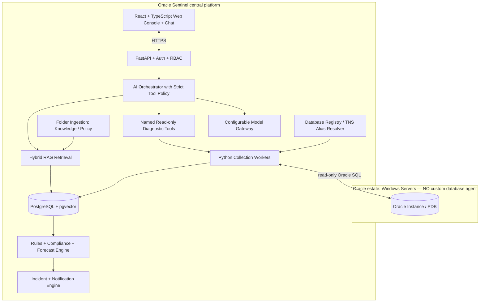

# Phase 0 — Bootstrap, Validation, and Architecture Decisions

**Phase:** 0  
**Status:** Pending  
**Prerequisites:** None  
**Master Plan:** [Oracle_Sentinel_AI_Implementation_Plan.md](Oracle_Sentinel_AI_Implementation_Plan.md)

---

## 1. Phase Overview

Set up the monorepo scaffold, Python 3.14 backend, React + TypeScript frontend, Docker Compose infrastructure, CI pipeline, and basic health endpoints. This phase establishes the foundation on which all subsequent phases build.

## 2. Shared Architecture Context

### 2.1 Non-Negotiable Principles
- **Monitoring never depends on an LLM.** Collection, rules, incidents, and alerts continue if AI is disabled.
- **No custom agent on target Oracle Windows servers** for baseline Oracle monitoring.
- **Read-only by default:** `GSYSTEM` is a local Oracle monitoring user, not a superuser.
- **Deny by default:** RBAC, per-database entitlements, named tool allowlists, bounded queries.
- **Evidence over confidence:** Link explanations to query results, event IDs, and versioned document citations.
- **Oracle licensing matters:** No AWR/ASH/ADDM unless explicitly licensed.
- **Extensibility:** Oracle-specific SQL stays inside `adapters/oracle`, not in core domain models.

### 2.2 Technology Stack

| Layer | Choice |
|---|---|
| Backend | Python 3.14, FastAPI, Pydantic v2 |
| Oracle Driver | python-oracledb (thin mode) |
| Frontend | TypeScript + React, Vite |
| Application DB | PostgreSQL + pgvector |
| Scheduler | APScheduler (early) → Celery + Redis |
| Local LLM | Ollama (dev), vLLM (production) |
| Document Parsing | PyMuPDF (PDF), python-docx (DOCX) |
| Auth | OIDC/OAuth2 with enterprise IdP |
| Notifications | SMTP initially |

### 2.3 Architecture Diagram



---

## 3. Deliverables

### 3.1 Backend

1. **Monorepo scaffold** — `backend/` directory with `pyproject.toml` containing all Phase 0 dependencies:
   - FastAPI, uvicorn
   - Pydantic v2, pydantic-settings
   - python-oracledb (thin mode)
   - SQLAlchemy 2.x, Alembic
   - APScheduler
   - pytest, pytest-asyncio
   - httpx (for testing)

2. **Package structure** — `backend/src/sentinel/` with all subpackages:
   ```
   backend/src/sentinel/
   ├── __init__.py
   ├── main.py              # FastAPI app entry point
   ├── api/v1/              # REST endpoints
   ├── auth/                # OIDC and RBAC (placeholder)
   ├── config/              # Typed settings, secret resolution
   ├── domain/              # Engine-agnostic models and enums
   ├── adapters/            # Database adapter implementations
   │   ├── __init__.py
   │   ├── base.py          # Protocol/ABC contracts
   │   ├── oracle/          # Oracle adapter (future)
   │   ├── mysql/           # Placeholder only
   │   └── sqlserver/       # Placeholder only
   ├── collectors/          # Scheduler, jobs, normalization
   ├── rules/               # Thresholds + policy checks
   ├── forecasting/         # Rates, capacity, confidence
   ├── incidents/           # Lifecycle, grouping, notifications
   ├── notifications/       # SMTP and webhook adapters
   ├── knowledge/           # Folder watcher, parsers, chunker
   ├── ai/                  # AI gateway, tools, orchestrator
   │   ├── providers/       # local, hosted, disabled
   │   ├── gateway.py
   │   ├── orchestrator.py
   │   ├── tools/           # Named tools
   │   └── safety.py
   ├── operations/          # Proposals + approval state
   ├── persistence/         # Models, repositories, migrations
   └── observability/       # Prometheus, logging, OpenTelemetry
   ```

3. **Configuration** — `backend/src/sentinel/config/`:
   - Typed settings using `pydantic-settings`
   - Environment variable resolution with `.env` support
   - Secret reference pattern (no hardcoded secrets)
   - `.env.example` at project root with all required variables

4. **FastAPI app** — `backend/src/sentinel/main.py`:
   - App factory with lifespan events
   - `/health/live` — application liveness check
   - `/health/ready` — dependency readiness (PostgreSQL connection)
   - OpenAPI schema generation
   - CORS middleware configuration

5. **Tests** — `backend/tests/`:
   - Unit tests for config loading
   - Health endpoint tests
   - Build and typecheck verification

### 3.2 Frontend

1. **Vite + React + TypeScript app** — `frontend/`:
   - `package.json` with dependencies (React, React Router, Vite, TypeScript)
   - Basic project structure with `src/` directory
   - API client setup (OpenAPI-generated types)
   - Basic layout with navigation shell

2. **Pages** (placeholder):
   - Fleet Dashboard (empty shell)
   - Database Detail (empty shell)
   - Navigation routing

3. **Tests** — `frontend/tests/`:
   - Component smoke tests
   - Build verification

### 3.3 Infrastructure

1. **Docker Compose** — `docker-compose.yml`:
   - PostgreSQL 16 with pgvector extension
   - Redis (for future Celery integration)
   - Ollama (optional, commented out by default)

2. **Environment configuration** — `.env.example`:
   - Database connection string
   - Redis connection
   - Oracle TNS_ADMIN path
   - AI provider settings
   - SMTP settings

3. **Knowledge intake folders** — `knowledge-intake/`:
   ```
   knowledge-intake/
   ├── Knowledge/
   ├── Policy/
   ├── Quarantine/
   └── README.md
   ```

4. **Documentation** — `docs/`:
   - `architecture.md` — high-level architecture overview
   - `adr/` — architectural decision records directory
   - `oracle-permissions.md` — GSYSTEM permission documentation
   - `security-threat-model.md` — initial threat model
   - `operations-runbook.md` — deployment and operations guide
   - `api-contracts.md` — API contract documentation

5. **Scripts** — `scripts/`:
   - `oracle/` — DBA-reviewed GSYSTEM provisioning templates
   - `demo/` — synthetic telemetry seed scripts
   - `validate-environment.py` — environment validation script

### 3.4 CI/CD

1. **GitHub Actions** or equivalent:
   - Python format/lint/test pipeline (ruff, mypy, pytest)
   - TypeScript typecheck and build pipeline
   - Secret scanning
   - Dependency auditing

---

## 4. Acceptance Criteria

- [ ] `docker compose up` starts PostgreSQL + pgvector and Redis without errors
- [ ] Backend tests pass on Python 3.14
- [ ] Frontend builds and typechecks without errors
- [ ] `/health/live` returns HTTP 200
- [ ] `/health/ready` returns HTTP 200 when PostgreSQL is reachable
- [ ] CI pipeline runs format, lint, and test checks
- [ ] No credential material is committed to the repository
- [ ] `.env.example` documents all required environment variables
- [ ] Architecture docs match the code structure

---

## 5. Tests

### 5.1 Backend Tests
- **Config loading** — verify settings load from environment variables
- **Health endpoints** — test `/health/live` and `/health/ready` responses
- **Build verification** — ensure `pyproject.toml` installs cleanly on Python 3.14

### 5.2 Frontend Tests
- **Build test** — `npm run build` succeeds
- **Typecheck** — `npm run typecheck` passes
- **Component smoke test** — basic layout renders

### 5.3 Integration Tests
- **Docker Compose** — services start and are reachable
- **PostgreSQL connection** — backend connects to PostgreSQL

---

## 6. Dependencies

### Python (backend/pyproject.toml)
```toml
[project]
name = "oracle-sentinel-backend"
version = "0.1.0"
requires-python = ">=3.14"
dependencies = [
    "fastapi>=0.118.3",
    "uvicorn[standard]>=0.30.0",
    "pydantic>=2.0",
    "pydantic-settings>=2.0",
    "python-oracledb>=3.3.0",
    "sqlalchemy>=2.0",
    "alembic>=1.13",
    "apscheduler>=3.10",
    "httpx>=0.27",
]

[project.optional-dependencies]
dev = [
    "pytest>=8.0",
    "pytest-asyncio>=0.24",
    "ruff>=0.4",
    "mypy>=1.11",
]
```

### npm (frontend/package.json)
```json
{
  "name": "oracle-sentinel-frontend",
  "version": "0.1.0",
  "dependencies": {
    "react": "^18.3",
    "react-dom": "^18.3",
    "react-router-dom": "^6.22",
    "@tanstack/react-query": "^5.40"
  },
  "devDependencies": {
    "@types/react": "^18.3",
    "@types/react-dom": "^18.3",
    "@vitejs/plugin-react": "^4.2",
    "typescript": "^5.4",
    "vite": "^5.2",
    "vitest": "^1.5"
  }
}
```

---

## 7. Key Files to Create

| File | Description |
|---|---|
| `backend/pyproject.toml` | Python project configuration |
| `backend/src/sentinel/__init__.py` | Package init |
| `backend/src/sentinel/main.py` | FastAPI app entry point |
| `backend/src/sentinel/config/__init__.py` | Configuration module |
| `backend/src/sentinel/config/settings.py` | Typed settings |
| `backend/src/sentinel/domain/__init__.py` | Domain models |
| `backend/src/sentinel/adapters/__init__.py` | Adapter registry |
| `backend/src/sentinel/adapters/base.py` | Adapter Protocol/ABC |
| `backend/src/sentinel/persistence/__init__.py` | Persistence layer |
| `backend/tests/__init__.py` | Test package |
| `backend/tests/test_health.py` | Health endpoint tests |
| `frontend/package.json` | Frontend dependencies |
| `frontend/vite.config.ts` | Vite configuration |
| `frontend/tsconfig.json` | TypeScript configuration |
| `frontend/src/main.tsx` | React entry point |
| `frontend/src/App.tsx` | Root component |
| `docker-compose.yml` | Docker Compose services |
| `.env.example` | Environment variable template |
| `knowledge-intake/README.md` | Knowledge intake documentation |
| `docs/architecture.md` | Architecture documentation |
| `docs/adr/README.md` | ADR index |
| `docs/oracle-permissions.md` | Oracle permissions guide |
| `docs/security-threat-model.md` | Security threat model |
| `docs/operations-runbook.md` | Operations runbook |
| `docs/api-contracts.md` | API contracts |
| `scripts/oracle/README.md` | Oracle scripts index |
| `scripts/validate-environment.py` | Environment validation |

---

## 8. Risks

- **Python 3.14 compatibility** — Verify each dependency supports Python 3.14 before pinning versions.
- **LangGraph compatibility** — If LangGraph has build issues with Python 3.14, isolate behind an interface and use deterministic workflows initially.
- **pgvector extension** — Ensure the PostgreSQL Docker image includes or can install the pgvector extension.

---

## 9. Cross-References

- **Master Plan:** [Oracle_Sentinel_AI_Implementation_Plan.md](Oracle_Sentinel_AI_Implementation_Plan.md)
- **Next Phase:** [Phase 1 — Oracle Connection](Phase_1_Oracle_Connection.md)
- **GSYSTEM Scripts:** [Oracle_Sentinel_GSYSTEM_ReadOnly_Provisioning.sql](Oracle_Sentinel_GSYSTEM_ReadOnly_Provisioning.sql)
- **TNS Example:** [Oracle_Sentinel_tnsnames_example.ora](Oracle_Sentinel_tnsnames_example.ora)
