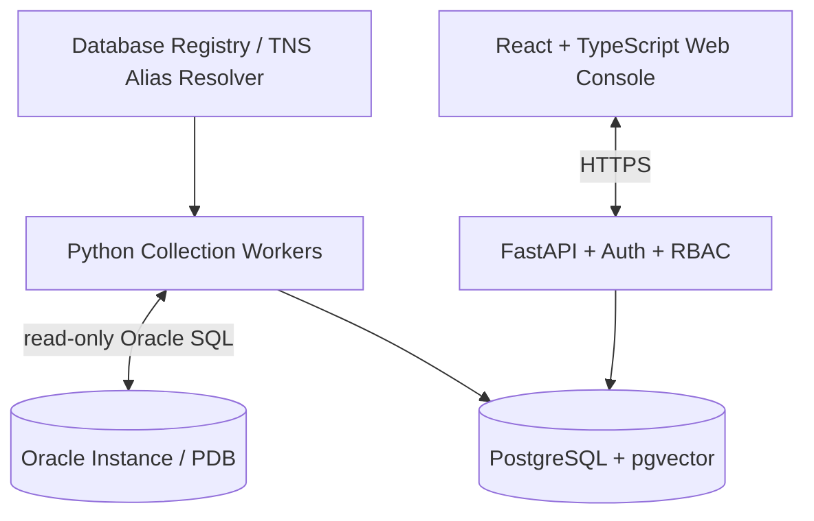

# Phase 1 — Oracle Connection and Read-Only Diagnostic Foundation

**Phase:** 1  
**Status:** Pending  
**Prerequisites:** Phase 0 (Bootstrap)  
**Master Plan:** [Oracle_Sentinel_AI_Implementation_Plan.md](Oracle_Sentinel_AI_Implementation_Plan.md)

---

## 1. Phase Overview

Build the Oracle connection layer: TNS-based database registry, GSYSTEM provisioning scripts, secret integration, connection testing, Oracle adapter with fixed SQL probes, and capability and permission checks. This phase enables the platform to connect to and collect read-only metrics from registered Oracle databases.

## 2. Shared Architecture Context

### 2.1 Non-Negotiable Principles
- **Monitoring never depends on an LLM.** Collection, rules, incidents, and alerts continue if AI is disabled.
- **No custom agent on target Oracle Windows servers** for baseline Oracle monitoring.
- **Read-only by default:** `GSYSTEM` is a local Oracle monitoring user, not a superuser.
- **Deny by default:** RBAC, per-database entitlements, named tool allowlists, bounded queries.
- **Evidence over confidence:** Link explanations to query results, event IDs, and versioned document citations.
- **Oracle licensing matters:** No AWR/ASH/ADDM unless explicitly licensed.
- **Extensibility:** Oracle-specific SQL stays inside `adapters/oracle`, not in core domain models.

### 2.2 Technology Stack

| Layer | Choice |
|---|---|
| Backend | Python 3.14, FastAPI, Pydantic v2 |
| Oracle Driver | python-oracledb (thin mode) |
| Frontend | TypeScript + React, Vite |
| Application DB | PostgreSQL + pgvector |
| Scheduler | APScheduler (early) → Celery + Redis |

### 2.3 Architecture Diagram



---

## 3. Deliverables

### 3.1 Backend

#### 3.1.1 TNS-Based Database Registry

**`backend/src/sentinel/domain/`** — Engine-agnostic models:

```python
from dataclasses import dataclass
from datetime import datetime
from enum import StrEnum
from typing import Any, Protocol

class Engine(StrEnum):
    ORACLE = "oracle"
    MYSQL = "mysql"          # future
    SQLSERVER = "sqlserver"  # future

@dataclass(frozen=True)
class Observation:
    database_id: str
    metric: str                # e.g. storage.tablespace.used_pct
    value: float | int | str | bool | None
    unit: str | None
    collected_at: datetime
    labels: dict[str, str]
    source: str                # named diagnostic probe
    quality: str = "measured"

@dataclass(frozen=True)
class DiagnosticEvent:
    database_id: str
    source_id: str             # stable source identifier
    occurred_at: datetime
    severity: str
    code: str | None
    message: str
    attributes: dict[str, Any]

class DatabaseAdapter(Protocol):
    engine: Engine
    async def test_connection(self, database_id: str) -> dict[str, Any]: ...
    async def collect_health(self, database_id: str) -> list[Observation]: ...
    async def collect_capacity(self, database_id: str) -> list[Observation]: ...
    async def collect_configuration(self, database_id: str) -> list[Observation]: ...
    async def poll_events(self, database_id: str, checkpoint: dict[str, Any] | None) -> tuple[list[DiagnosticEvent], dict[str, Any]]: ...
    async def run_named_diagnostic(self, database_id: str, tool_name: str, arguments: dict[str, Any]) -> dict[str, Any]: ...
```

#### 3.1.2 Oracle Adapter

**`backend/src/sentinel/adapters/oracle/`**:

1. **Connection manager** — TNS-based connection using `python-oracledb`:
   - Resolve TNS alias from `TNS_ADMIN` environment variable
   - Bounded connection pooling with statement deadlines
   - Exponential backoff with jitter on failures
   - TLS/TCPS support where required

2. **Fixed SQL probes** — Read-only queries for:
   - **Instance status:** `V$INSTANCE`, `V$DATABASE` (status, role, open mode, version, uptime, archive mode)
   - **Storage:** `DBA_TABLESPACES`, `DBA_DATA_FILES`, `DBA_FREE_SPACE`, `DBA_TEMP_FILES`, `DBA_TABLESPACE_USAGE_METRICS`
   - **FRA/Archive:** `V$RECOVERY_FILE_DEST`, `V$FLASH_RECOVERY_AREA_USAGE`, `V$ARCHIVE_DEST_STATUS`
   - **Sessions/Resources:** `V$RESOURCE_LIMIT`
   - **Configuration:** `V$PARAMETER` (OMF, ARCHIVELOG, FRA, Flashback settings)

3. **Capability detection** — After login:
   - Detect Oracle version and edition
   - Verify PDB/CDB context
   - Check available views and privileges
   - Build capability matrix (e.g., `supports_awr`, `supports_flashback`, `supports_windows_event_forwarding`)
   - Record capability snapshot in `database_targets`

4. **Alert-log polling** — `V$DIAG_ALERT_EXT`:
   - Incremental polling with checkpoint management
   - Deduplication using `RECORD_ID` or stable composite key
   - Bounded page size and maximum lookback
   - Sanitize alert lines before storage

5. **Synthetic Oracle adapter** — For testing without real Oracle credentials:
   - Mock connection and query results
   - Simulate different Oracle versions (19c, 21c, 23ai, 26ai)
   - Simulate permission-denied scenarios

#### 3.1.3 MySQL and SQL Server Placeholders

**`backend/src/sentinel/adapters/mysql/`** and **`backend/src/sentinel/adapters/sqlserver/`**:
- Interface placeholders implementing `DatabaseAdapter` Protocol
- All methods return `not_supported` capabilities
- No R1 implementation

#### 3.1.4 Persistence

**`backend/src/sentinel/persistence/`** — SQLAlchemy 2.x models:

| Table | Important Fields |
|---|---|
| `database_targets` | UUID, engine, display_name, tns_alias, environment, owner, enabled, poll_profile, capability_snapshot, created_at |
| `target_credentials` | target UUID, secret reference (never actual password), rotation timestamp |
| `observations` | target UUID, metric_name, timestamp, value, unit, labels JSONB, quality |
| `diagnostic_events` | target UUID, source, source_event_key UNIQUE, occurred_at, severity, code, message, raw payload |
| `collector_checkpoints` | target UUID, collector type, cursor JSONB, updated_at |

- Alembic migrations for all tables
- Repository pattern for data access

#### 3.1.5 API Endpoints

**`backend/src/sentinel/api/v1/`**:

| Method | Path | Description |
|---|---|---|
| `GET` | `/api/v1/databases` | List registered databases |
| `POST` | `/api/v1/databases` | Register new database (TNS alias, metadata) |
| `GET` | `/api/v1/databases/{id}` | Database detail and capabilities |
| `POST` | `/api/v1/databases/{id}/test-connection` | Test Oracle connection |
| `GET` | `/api/v1/databases/{id}/metrics` | Latest metrics for a database |

#### 3.1.6 GSYSTEM Scripts

**`scripts/oracle/`** — DBA-reviewed provisioning templates:
- Reference existing `Oracle_Sentinel_GSYSTEM_ReadOnly_Provisioning.sql`
- `01_create_gsystem.sql` — Create local GSYSTEM user per approved PDB/non-CDB
- `02_grant_readonly_monitoring.sql` — Narrow SELECT grants on specific V_$ objects
- `03_verify_gsystem.sql` — Execute diagnostic queries and capture capability matrix
- `04_revoke_gsystem.sql` — Emergency revoke/disconnect guidance

### 3.2 Frontend

#### 3.2.1 Database Registry Page

- **List view** — Table of registered databases with:
  - Name, environment, TNS alias
  - Health status (healthy/warning/critical/unknown/offline)
  - Last connection time
  - Engine type and version

- **Register dialog** — Form to add new database:
  - Display name, environment, TNS alias selection
  - Business owner, timezone, tags
  - No password in payload (secret reference only)

- **Test connection** — Button to verify connectivity and display capability matrix

### 3.3 Infrastructure

- **TNS configuration** — `TNS_ADMIN` environment variable pointing to read-only Oracle Net directory
- **Secret management** — Secret reference pattern for Oracle credentials
- **Connection pooling** — Bounded pooling configuration in settings

---

## 4. Acceptance Criteria

- [ ] One approved Oracle target returns instance status, database role, tablespace/FRA/configuration metrics
- [ ] Disconnected targets show explicit `offline` status (not `healthy`)
- [ ] Insufficient-privilege targets show explicit `permission_denied` status
- [ ] No writes to target possible using `GSYSTEM`
- [ ] No custom host agent required on target servers
- [ ] Capability detection correctly identifies Oracle version and available views
- [ ] PDB/CDB context is verified after login
- [ ] Connection test endpoint works for valid and invalid TNS aliases
- [ ] Database registry CRUD operations work correctly
- [ ] Observations are persisted with timestamps and quality flags

---

## 5. Tests

### 5.1 Unit Tests
- **Oracle adapter with mock** — Test each probe returns expected `Observation` objects
- **Capability detection** — Verify version and privilege detection logic
- **Connection test** — Test valid and invalid TNS alias resolution
- **Domain models** — Test `Observation`, `DiagnosticEvent`, and `DatabaseAdapter` Protocol

### 5.2 Integration Tests
- **Database migrations** — Verify Alembic migrations apply cleanly
- **API endpoints** — Test database registry CRUD and connection test
- **Persistence** — Test observation storage and retrieval

### 5.3 Security Tests
- **Read-only verification** — Confirm GSYSTEM cannot execute DDL
- **Credential handling** — Verify no passwords in source control or API payloads
- **Connection error redaction** — Ensure sensitive details are not exposed in error messages

### 5.4 Edge Cases
- **Disconnected targets** — Verify explicit offline status
- **Permission denied** — Verify explicit permission_denied status
- **Oracle version variations** — Test with simulated 19c, 21c, 23ai, 26ai
- **PDB vs CDB context** — Verify container verification works

---

## 6. Dependencies

### Python (additional to Phase 0)
```toml
# No new dependencies beyond Phase 0
# python-oracledb>=3.3.0 already listed
```

---

## 7. Key Files to Create

| File | Description |
|---|---|
| `backend/src/sentinel/domain/models.py` | Engine-agnostic models |
| `backend/src/sentinel/domain/enums.py` | Engine enum and other enums |
| `backend/src/sentinel/adapters/base.py` | DatabaseAdapter Protocol |
| `backend/src/sentinel/adapters/oracle/__init__.py` | Oracle adapter package |
| `backend/src/sentinel/adapters/oracle/connection.py` | TNS connection manager |
| `backend/src/sentinel/adapters/oracle/probes.py` | Fixed SQL probes |
| `backend/src/sentinel/adapters/oracle/capabilities.py` | Capability detection |
| `backend/src/sentinel/adapters/oracle/alert_log.py` | Alert-log polling |
| `backend/src/sentinel/adapters/oracle/synthetic.py` | Synthetic adapter for tests |
| `backend/src/sentinel/adapters/mysql/__init__.py` | MySQL placeholder |
| `backend/src/sentinel/adapters/sqlserver/__init__.py` | SQL Server placeholder |
| `backend/src/sentinel/persistence/models.py` | SQLAlchemy models |
| `backend/src/sentinel/persistence/repositories.py` | Repository pattern |
| `backend/src/sentinel/api/v1/databases.py` | Database registry endpoints |
| `backend/tests/adapters/test_oracle.py` | Oracle adapter tests |
| `backend/tests/adapters/test_synthetic.py` | Synthetic adapter tests |
| `backend/tests/api/test_databases.py` | Database API tests |
| `frontend/src/features/databases/` | Database registry UI |
| `scripts/oracle/01_create_gsystem.sql` | GSYSTEM user creation |
| `scripts/oracle/02_grant_readonly_monitoring.sql` | Read-only grants |
| `scripts/oracle/03_verify_gsystem.sql` | Verification script |
| `scripts/oracle/04_revoke_gsystem.sql` | Revoke script |

---

## 8. Risks

- **Oracle version variations** — View availability and columns differ across 19c/21c/23ai/26ai. Mitigation: capability detection after login.
- **PDB vs CDB context** — GSYSTEM is a local PDB user; some views may not be visible. Mitigation: container verification.
- **TNS configuration** — `TNS_ADMIN` must be correctly set and accessible. Mitigation: validation script and clear error messages.
- **python-oracledb thin mode** — Verify thin mode supports all required features for target Oracle versions.

---

## 9. Cross-References

- **Master Plan:** [Oracle_Sentinel_AI_Implementation_Plan.md](Oracle_Sentinel_AI_Implementation_Plan.md)
- **Previous Phase:** [Phase 0 — Bootstrap](Phase_0_Bootstrap.md)
- **Next Phase:** [Phase 2 — Central Collection](Phase_2_Central_Collection.md)
- **GSYSTEM Scripts:** [Oracle_Sentinel_GSYSTEM_ReadOnly_Provisioning.sql](Oracle_Sentinel_GSYSTEM_ReadOnly_Provisioning.sql)
- **TNS Example:** [Oracle_Sentinel_tnsnames_example.ora](Oracle_Sentinel_tnsnames_example.ora)
