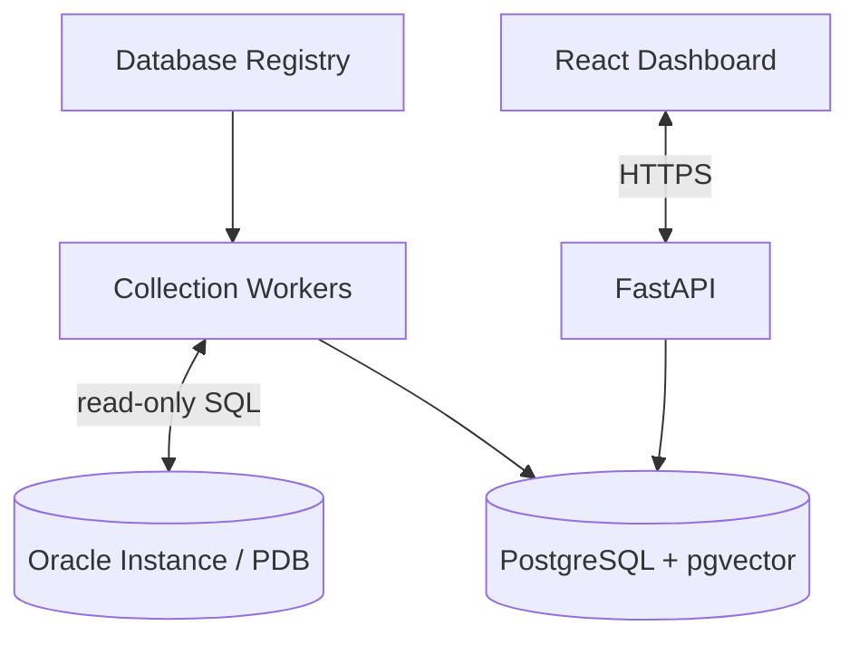

# Phase 2 — Central Collection, Storage, and Dashboard

**Phase:** 2  
**Status:** Implemented; synthetic validation completed, live PostgreSQL/Oracle acceptance required
**Prerequisites:** Phase 1 (Oracle Connection)  
**Master Plan:** [Oracle_Sentinel_AI_Implementation_Plan.md](Oracle_Sentinel_AI_Implementation_Plan.md)

---

## 1. Phase Overview

Build the central collection pipeline: APScheduler-based scheduler, polling jobs for each probe type, checkpoints, normalization, fleet and target detail endpoints, and a functional React dashboard with live refresh. This phase enables continuous monitoring of registered Oracle databases and presents the data in a web portal.

## 2. Shared Architecture Context

### 2.1 Non-Negotiable Principles
- **Monitoring never depends on an LLM.** Collection, rules, incidents, and alerts continue if AI is disabled.
- **No custom agent on target Oracle Windows servers** for baseline Oracle monitoring.
- **Read-only by default:** `GSYSTEM` is a local Oracle monitoring user, not a superuser.
- **Deny by default:** RBAC, per-database entitlements, named tool allowlists, bounded queries.
- **Evidence over confidence:** Link explanations to query results, event IDs, and versioned document citations.
- **Oracle licensing matters:** No AWR/ASH/ADDM unless explicitly licensed.
- **Extensibility:** Oracle-specific SQL stays inside `adapters/oracle`, not in core domain models.

### 2.2 Technology Stack

| Layer | Choice |
|---|---|
| Backend | Python 3.14, FastAPI, Pydantic v2 |
| Oracle Driver | python-oracledb (thin mode) |
| Frontend | TypeScript + React, Vite |
| Application DB | PostgreSQL + pgvector |
| Scheduler | APScheduler |

### 2.3 Architecture Diagram



---

## 3. Deliverables

### 3.1 Backend

#### 3.1.1 APScheduler-Based Scheduler

**`backend/src/sentinel/collectors/`**:

1. **Scheduler service** — APScheduler integration:
   - Configurable poll profiles (e.g., `critical`, `standard`, `lightweight`)
   - Per-database poll frequency based on environment and profile
   - Job deduplication — avoid duplicate jobs for the same target
   - Graceful shutdown and restart recovery

2. **Polling jobs** — One job per probe type per target:
   - **Connectivity probe** — 1 minute interval
   - **Instance/database mode** — 5 minutes
   - **Storage (tablespace)** — 5 minutes
   - **FRA/archive** — 2–5 minutes
   - **Sessions/resources** — 2–5 minutes
   - **Compliance configuration** — 15–60 minutes

3. **Checkpoints** — Persistent state management:
   - Store checkpoint after each successful poll run
   - Lease/version mechanism to prevent concurrent jobs
   - Recovery after crash using last checkpoint

4. **Normalization** — Raw query results to `Observation` objects:
   - Metric naming convention (e.g., `storage.tablespace.used_pct`)
   - Unit standardization (percent, bytes, count)
   - Label enrichment (tablespace_name, file_name, etc.)
   - Quality flags (`measured`, `estimated`, `stale`)

5. **Stale telemetry handling** — No data must not appear as healthy:
   - Configurable staleness threshold per probe type
   - Automatic status change to `unknown` when telemetry is stale
   - Separate alert type for polling failures

#### 3.1.2 Persistence

**`backend/src/sentinel/persistence/`** — New SQLAlchemy models:

| Table | Important Fields |
|---|---|
| `poll_runs` | UUID, target UUID, probe type, started_at, finished_at, status, error_class, duration_seconds |
| `collector_checkpoints` | target UUID, collector type, cursor JSONB, updated_at, lease_version |

- Alembic migrations for new tables
- Repository methods for poll run tracking and checkpoint management

#### 3.1.3 API Endpoints

**`backend/src/sentinel/api/v1/`**:

| Method | Path | Description |
|---|---|---|
| `GET` | `/api/v1/databases` | Paginated fleet health with filtering |
| `GET` | `/api/v1/databases/{id}` | Overview, capability flags, last-seen, monitoring status |
| `GET` | `/api/v1/databases/{id}/metrics` | Time-range chart series, bounded |
| `GET` | `/api/v1/databases/{id}/observations` | Raw observations with filters |

#### 3.1.4 Health Status Computation

- **`healthy`** — Fresh measurements and passing critical probes
- **`warning`** — Thresholds exceeded (e.g., tablespace > 85%)
- **`critical`** — Serious confirmed condition (e.g., tablespace > 95%)
- **`unknown`** — Telemetry stale or permissions missing
- **`offline`** — Connectivity probe fails

### 3.2 Frontend

#### 3.2.1 Fleet Dashboard

- **Database cards/table** — Overview of all registered databases:
  - Name, environment, health status (color + text, accessible)
  - Last update timestamp
  - Critical incident counts
  - Trend snapshots

- **Filters** — Environment filter, health status filter
- **Live refresh** — Automatic polling for updates (configurable interval)

#### 3.2.2 Database Detail Page

- **Header** — Version, role/PDB, availability status
- **Tablespaces** — Table with used %, file size, autoextend status
- **FRA** — Recovery destination size/used, usage breakdown
- **Archive state** — Archive mode, destination errors
- **Timeline charts** — Historical metrics with time-range selection
- **Compliance summary** — Pass/fail/unknown counts

#### 3.2.3 Components

- **Health status badge** — Accessible color + text indicator
- **Metric card** — Display single metric with trend
- **Tablespace table** — Sortable table with used % visualization
- **FRA gauge** — Visual representation of FRA usage
- **Timeline chart** — Recharts or Apache ECharts integration

### 3.3 Infrastructure

- **Scheduler configuration** — Poll profiles and frequencies in settings
- **Data retention** — Initial retention policy for observations
- **Fixtures** — Synthetic data for disconnected targets

---

## 4. Acceptance Criteria

The implementation is covered by backend tests and frontend tests/build, with a
credential-free synthetic fleet available for UI validation. Check the boxes below
for your deployment after following [the operations runbook](docs/operations-runbook.md).
Incident counts remain unavailable until Phase 3; collected compliance configuration
is intentionally shown as unevaluated/unknown until Phase 4.

- [ ] At least two registered targets with distinct health states appear correctly on the dashboard
- [ ] Stale telemetry shows `unknown` status (not `healthy`)
- [ ] Metrics display timestamps and evidence
- [ ] Refresh does not trigger uncontrolled full scans
- [ ] Fleet dashboard shows all registered databases with correct health status
- [ ] Database detail page shows version, role/PDB, tablespaces, FRA, and archive state
- [ ] Timeline charts display historical data with time-range selection
- [ ] Polling jobs run at configured intervals
- [ ] Checkpoints are persisted and recovered after restart
- [ ] Disconnected targets show explicit `offline` status

---

## 5. Tests

### 5.1 Unit Tests
- **Scheduler jobs** — Test job scheduling and execution with test doubles
- **Stale telemetry handling** — Verify `unknown` status when telemetry is stale
- **Normalization** — Test raw query results to `Observation` conversion
- **Health status computation** — Test status logic for various scenarios

### 5.2 Integration Tests
- **Poll runs** — Verify poll run tracking and checkpoint management
- **API endpoints** — Test fleet and target detail endpoints
- **Dashboard data** — Verify data flows from collectors to API to frontend

### 5.3 Edge Cases
- **Disconnected targets** — Verify explicit offline status and handling
- **Insufficient history** — Verify graceful handling when no data exists
- **Rapid refresh** — Verify no duplicate jobs or uncontrolled scans
- **Collector crash** — Verify checkpoint recovery after crash

### 5.4 Frontend Tests
- **Dashboard rendering** — Test fleet dashboard with mock data
- **Database detail** — Test detail page with various health states
- **Charts** — Test timeline chart rendering with sample data

---

## 6. Dependencies

### Python (additional to Phase 1)
```toml
# APScheduler already listed in Phase 0
# No new dependencies
```

### npm (additional to Phase 0)
```json
{
  "dependencies": {
    "recharts": "^2.12"
  }
}
```

---

## 7. Key Files to Create

| File | Description |
|---|---|
| `backend/src/sentinel/collectors/__init__.py` | Collectors package |
| `backend/src/sentinel/collectors/scheduler.py` | APScheduler service |
| `backend/src/sentinel/collectors/jobs.py` | Polling jobs |
| `backend/src/sentinel/collectors/checkpoints.py` | Checkpoint management |
| `backend/src/sentinel/collectors/normalization.py` | Observation normalization |
| `backend/src/sentinel/collectors/health_status.py` | Health status computation |
| `backend/src/sentinel/api/v1/metrics.py` | Metrics endpoints |
| `backend/src/sentinel/persistence/models.py` | Add poll_runs model |
| `backend/tests/collectors/test_scheduler.py` | Scheduler tests |
| `backend/tests/collectors/test_jobs.py` | Job tests |
| `backend/tests/collectors/test_health_status.py` | Health status tests |
| `frontend/src/features/fleet/` | Fleet Dashboard |
| `frontend/src/features/database-detail/` | Database Detail page |
| `frontend/src/components/HealthBadge.tsx` | Health status badge |
| `frontend/src/components/MetricCard.tsx` | Metric display card |
| `frontend/src/components/TablespaceTable.tsx` | Tablespace table |
| `frontend/src/components/TimelineChart.tsx` | Timeline chart |

---

## 8. Risks

- **APScheduler limitations** — Single-process scheduler may not be sufficient for production. Mitigation: plan migration to Celery + Redis.
- **Data volume** — High-frequency polling can generate large observation tables. Mitigation: partitioning and retention policies.
- **Poll frequency tuning** — Default frequencies may need adjustment based on fleet size and Oracle versions. Mitigation: configurable poll profiles.

---

## 9. Cross-References

- **Master Plan:** [Oracle_Sentinel_AI_Implementation_Plan.md](Oracle_Sentinel_AI_Implementation_Plan.md)
- **Previous Phase:** [Phase 1 — Oracle Connection](Phase_1_Oracle_Connection.md)
- **Next Phase:** [Phase 3 — Alert-Log, Rules, and Incidents](Phase_3_AlertLog_Rules_Incidents.md)
