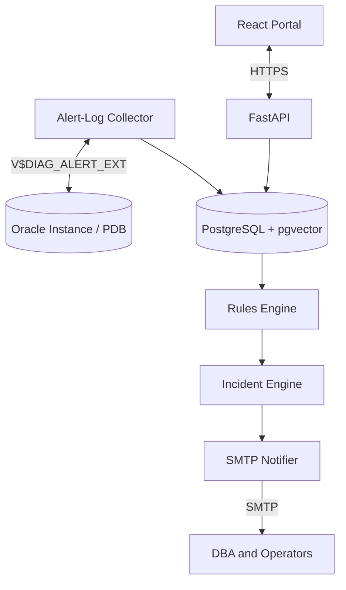

# Phase 3 — Alert-Log Ingestion, Rules, and Incidents

**Phase:** 3  
**Status:** Pending  
**Prerequisites:** Phase 2 (Central Collection)  
**Master Plan:** [Oracle_Sentinel_AI_Implementation_Plan.md](Oracle_Sentinel_AI_Implementation_Plan.md)

---

## 1. Phase Overview

Build the alert-log ingestion pipeline, rules engine with YAML definitions, incident lifecycle management, and SMTP notifications. This phase enables the platform to detect problems from Oracle alert logs, evaluate configurable monitoring rules, generate deduplicated incidents, and notify DBAs via email.

## 2. Shared Architecture Context

### 2.1 Non-Negotiable Principles
- **Monitoring never depends on an LLM.** Collection, rules, incidents, and alerts continue if AI is disabled.
- **No custom agent on target Oracle Windows servers** for baseline Oracle monitoring.
- **Read-only by default:** `GSYSTEM` is a local Oracle monitoring user, not a superuser.
- **Deny by default:** RBAC, per-database entitlements, named tool allowlists, bounded queries.
- **Evidence over confidence:** Link explanations to query results, event IDs, and versioned document citations.
- **Oracle licensing matters:** No AWR/ASH/ADDM unless explicitly licensed.
- **Extensibility:** Oracle-specific SQL stays inside `adapters/oracle`, not in core domain models.

### 2.2 Technology Stack

| Layer | Choice |
|---|---|
| Backend | Python 3.14, FastAPI, Pydantic v2 |
| Oracle Driver | python-oracledb (thin mode) |
| Frontend | TypeScript + React, Vite |
| Application DB | PostgreSQL + pgvector |
| Notifications | SMTP |

### 2.3 Architecture Diagram



---

## 3. Deliverables

### 3.1 Backend

#### 3.1.1 Alert-Log Collector

**`backend/src/sentinel/collectors/`** — Alert-log specific collector:

1. **`V$DIAG_ALERT_EXT` polling**:
   - Incremental polling using checkpoint (last `RECORD_ID` or timestamp)
   - Capture `ORIGINATING_TIMESTAMP`, `MESSAGE_TEXT`, message attributes, component, instance/container identifiers
   - Stable dedup key from source metadata
   - Bounded page size and maximum lookback
   - Advance checkpoints only after transactionally persisting fetched events

2. **Source deduplication**:
   - Deduplicate by `source_event_key` (unique constraint in `diagnostic_events`)
   - Handle same-timestamp events and log rotation
   - Overlap windows to prevent gaps

3. **Sanitization**:
   - Remove connection details, SQL literals, PII, secrets, and stack dumps from alert lines before AI prompts
   - Store raw secured payload separately from normalized message

4. **Overlap and backfill**:
   - Support explicit historical backfill with access controls
   - Handle log rotation and backfill scenarios

#### 3.1.2 Rules Engine

**`backend/src/sentinel/rules/`**:

1. **YAML rule definitions** — Safe Python predicates (not `eval()` or arbitrary SQL):
   ```yaml
   rules:
     - id: tablespace_warning
       enabled: true
       scope: all
       expression: storage.tablespace.used_pct > 85
       hysteresis: 2
       cooldown_minutes: 30
       severity: warning
       message: "Tablespace {tablespace_name} is {value}% full"
       
     - id: tablespace_critical
       enabled: true
       scope: all
       expression: storage.tablespace.used_pct > 95
       hysteresis: 1
       cooldown_minutes: 15
       severity: critical
       message: "Tablespace {tablespace_name} is critically full at {value}%"
       
     - id: fra_warning
       enabled: true
       scope: all
       expression: storage.fra.used_pct > 80
       hysteresis: 2
       cooldown_minutes: 30
       severity: warning
       message: "FRA is {value}% full"
       
     - id: fra_critical
       enabled: true
       scope: all
       expression: storage.fra.used_pct > 95
       hysteresis: 1
       cooldown_minutes: 15
       severity: critical
       message: "FRA is critically full at {value}%"
       
     - id: ora_00257
       enabled: true
       scope: all
       expression: diagnostic_events.code == 'ORA-00257'
       cooldown_minutes: 60
       severity: critical
       message: "Archive log destination full (ORA-00257)"
   ```

2. **Threshold evaluation**:
   - Hysteresis — minimum consecutive samples before firing
   - Cooldown — minimum time between firings for the same rule
   - Maintenance suppression — skip evaluation during maintenance windows
   - Deduplication — one incident per rule per target per cooldown period

3. **Initial rules**:
   - Database unreachable
   - Instance not open/expected mode
   - Tablespace over 85% warning and 95% critical (per environment overrides)
   - FRA over 80%/95%
   - Archive destination error
   - Recurring ORA-00257, ORA-01653, ORA-04031
   - Rising session/process utilization
   - Polling failures/stale telemetry

#### 3.1.3 Incident Lifecycle

**`backend/src/sentinel/incidents/`**:

1. **Incident state machine**:
   - States: `new` → `acknowledged` → `resolved`
   - Transitions are auditable with actor, timestamp, and reason

2. **Fingerprinting**:
   - Group related events by fingerprint (rule_id + target + normalized key)
   - Avoid duplicate incidents for the same underlying problem

3. **Grouping**:
   - Related incidents are linked (e.g., ORA-00257 and FRA critical)
   - Root-cause candidate tracking

4. **Incident events**:
   - Track state changes, notes, and evidence references
   - Immutable history

#### 3.1.4 SMTP Notifications

**`backend/src/sentinel/notifications/`**:

1. **SMTP adapter**:
   - Configurable SMTP server, port, TLS, authentication
   - Template-based email generation
   - Retry with exponential backoff
   - Deduplication — avoid sending duplicate notifications

2. **Notification channels**:
   - Initial: SMTP only
   - Future: Teams/webhooks adapter

3. **Escalation**:
   - Configurable escalation policies
   - Throttle to prevent notification storms

#### 3.1.5 Persistence

**`backend/src/sentinel/persistence/`** — New SQLAlchemy models:

| Table | Important Fields |
|---|---|
| `rule_definitions` | rule id, enabled, scope, expression/threshold, cooldown, severity |
| `incidents` | UUID, fingerprint, target UUID, state, severity, first_seen, last_seen, owner, root_cause_candidate |
| `incident_events` | incident UUID, type, timestamp, actor, before/after, evidence refs |
| `notifications` | incident UUID, channel, recipient, attempt_count, status, dedup_id |

- Alembic migrations for all new tables

#### 3.1.6 API Endpoints

**`backend/src/sentinel/api/v1/`**:

| Method | Path | Description |
|---|---|---|
| `GET` | `/api/v1/incidents` | List incidents with severity/state/owner filters |
| `GET` | `/api/v1/incidents/{id}` | Incident detail and history |
| `POST` | `/api/v1/incidents/{id}/acknowledge` | Acknowledge incident |
| `POST` | `/api/v1/incidents/{id}/resolve` | Resolve incident with reason |
| `GET` | `/api/v1/databases/{id}/events` | Oracle alert-log timeline and filters |
| `GET` | `/api/v1/notifications` | List notifications |

### 3.2 Frontend

#### 3.2.1 Incident Center

- **List view** — Table of incidents with:
  - Status (new/acknowledged/resolved)
  - Severity (warning/critical)
  - Target database
  - First seen / last seen timestamps
  - Owner

- **Detail view** — Incident history, evidence, notes
- **Actions** — Acknowledge, resolve with reason

#### 3.2.2 Logs/Events Page

- **Searchable Oracle alert log** — Full-text search
- **ORA-code filters** — Filter by ORA-00257, ORA-01653, etc.
- **Date range** — Time-range selection
- **Linked incidents** — Show related incidents for each event

### 3.3 Infrastructure

- **SMTP configuration** — Settings for SMTP server, credentials, and templates
- **Rule definitions** — YAML files with initial rules
- **Notification templates** — Email templates for different severities

---

## 4. Acceptance Criteria

- [ ] Synthetic ORA-00257 events lead to one deduplicated incident and one notification
- [ ] FRA overload scenario generates correct incident and notification
- [ ] Restart resumes alert-log collection without gaps beyond documented limitations
- [ ] Notification failures are retried with backoff
- [ ] LLM disabled causes no impact on rules, incidents, or notifications
- [ ] Duplicate alert events are deduplicated
- [ ] Incident state machine enforces valid transitions
- [ ] Notifications are sent within configured SLO
- [ ] Rules evaluate correctly with hysteresis and cooldown
- [ ] Maintenance windows suppress rule evaluation

---

## 5. Tests

### 5.1 Unit Tests
- **Rules engine** — Test threshold evaluation with hysteresis, cooldown, and deduplication
- **Incident state machine** — Test valid and invalid state transitions
- **Fingerprinting** — Test grouping of related events
- **SMTP adapter** — Test email generation and retry logic with mocks

### 5.2 Integration Tests
- **Synthetic ORA-00257 scenario** — End-to-end test from alert event to incident to notification
- **Deduplication** — Verify duplicate events produce one incident
- **Notification retry** — Verify retry on SMTP failure
- **No-LLM resilience** — Set `ai.enabled=false` and verify all functions work

### 5.3 Edge Cases
- **Collector crash before checkpoint** — Verify no data loss
- **Same-timestamp events** — Verify correct deduplication
- **Log rotation** — Verify handling of rotated logs
- **Notification storm** — Verify throttle prevents excessive notifications

### 5.4 Security Tests
- **Alert message injection** — Verify malicious alert messages cannot bypass safeguards
- **Unauthorized access** — Verify incident actions require proper authorization

---

## 6. Dependencies

### Python (additional to Phase 2)
```toml
# No new dependencies — SMTP is in Python stdlib
# PyYAML for rule definitions (if not already present)
"pyyaml>=6.0"
```

---

## 7. Key Files to Create

| File | Description |
|---|---|
| `backend/src/sentinel/collectors/alert_log.py` | Alert-log collector |
| `backend/src/sentinel/rules/__init__.py` | Rules package |
| `backend/src/sentinel/rules/engine.py` | Rules evaluation engine |
| `backend/src/sentinel/rules/definitions.py` | Rule definition models |
| `backend/src/sentinel/rules/yaml_loader.py` | YAML rule loader |
| `backend/src/sentinel/incidents/__init__.py` | Incidents package |
| `backend/src/sentinel/incidents/lifecycle.py` | Incident state machine |
| `backend/src/sentinel/incidents/fingerprinting.py` | Incident fingerprinting |
| `backend/src/sentinel/notifications/__init__.py` | Notifications package |
| `backend/src/sentinel/notifications/smtp.py` | SMTP adapter |
| `backend/src/sentinel/notifications/templates.py` | Email templates |
| `backend/src/sentinel/api/v1/incidents.py` | Incident endpoints |
| `backend/src/sentinel/api/v1/events.py` | Events endpoints |
| `backend/src/sentinel/persistence/models.py` | Add rule/incident/notification models |
| `backend/tests/rules/test_engine.py` | Rules engine tests |
| `backend/tests/incidents/test_lifecycle.py` | Incident lifecycle tests |
| `backend/tests/notifications/test_smtp.py` | SMTP tests |
| `backend/tests/integration/test_alert_flow.py` | End-to-end alert flow test |
| `frontend/src/features/incidents/` | Incident Center |
| `frontend/src/features/events/` | Logs/Events page |
| `rules/` | YAML rule definition files |

---

## 8. Risks

- **V$DIAG_ALERT_EXT availability** — View may not be available on all Oracle versions or PDB contexts. Mitigation: capability detection and graceful degradation.
- **Alert log volume** — High-volume databases can generate many alert events. Mitigation: bounded page size and deduplication.
- **SMTP reliability** — SMTP server may be unavailable. Mitigation: retry with backoff and dead letter queue.
- **Rule complexity** — Complex rules may be difficult to maintain. Mitigation: simple YAML syntax and validation.

---

## 9. Cross-References

- **Master Plan:** [Oracle_Sentinel_AI_Implementation_Plan.md](Oracle_Sentinel_AI_Implementation_Plan.md)
- **Previous Phase:** [Phase 2 — Central Collection](Phase_2_Central_Collection.md)
- **Next Phase:** [Phase 4 — Compliance and Forecasting](Phase_4_Compliance_Forecasting.md)
