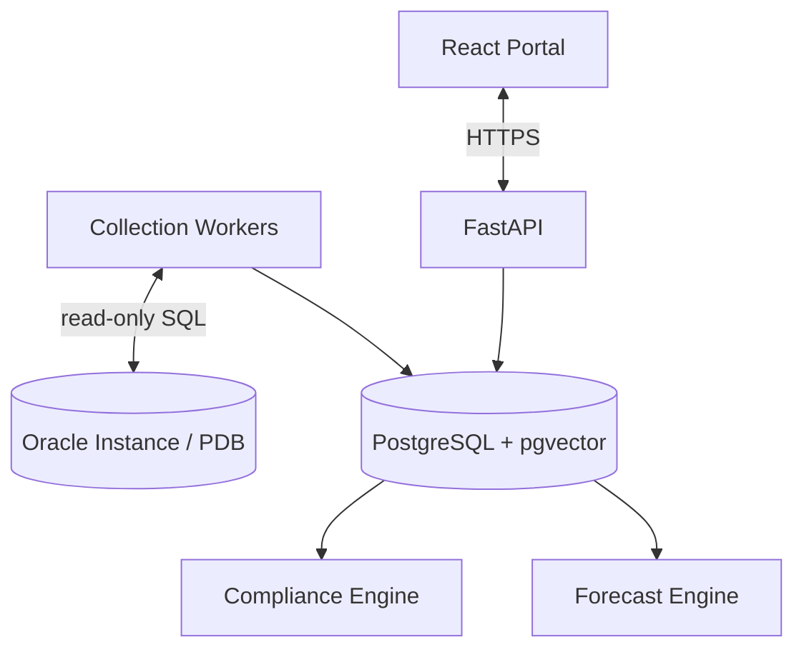

# Phase 4 — Compliance and Proactive Analysis

**Phase:** 4  
**Status:** Implemented; live Oracle validation remains
**Prerequisites:** Phase 3 (Alert-Log, Rules, and Incidents)  
**Master Plan:** [Oracle_Sentinel_AI_Implementation_Plan.md](Oracle_Sentinel_AI_Implementation_Plan.md)

---

## 1. Phase Overview

Build the versioned compliance policy engine and trend-based capacity forecasting. This phase enables the platform to evaluate Oracle databases against configurable compliance policies (OMF, ARCHIVELOG, FRA, Flashback) and predict capacity exhaustion based on historical trends.

## 2. Shared Architecture Context

### 2.1 Non-Negotiable Principles
- **Monitoring never depends on an LLM.** Collection, rules, incidents, and alerts continue if AI is disabled.
- **No custom agent on target Oracle Windows servers** for baseline Oracle monitoring.
- **Read-only by default:** `GSYSTEM` is a local Oracle monitoring user, not a superuser.
- **Deny by default:** RBAC, per-database entitlements, named tool allowlists, bounded queries.
- **Evidence over confidence:** Link explanations to query results, event IDs, and versioned document citations.
- **Oracle licensing matters:** No AWR/ASH/ADDM unless explicitly licensed.
- **Extensibility:** Oracle-specific SQL stays inside `adapters/oracle`, not in core domain models.

### 2.2 Technology Stack

| Layer | Choice |
|---|---|
| Backend | Python 3.14, FastAPI, Pydantic v2 |
| Oracle Driver | python-oracledb (thin mode) |
| Frontend | TypeScript + React, Vite |
| Application DB | PostgreSQL + pgvector |

### 2.3 Architecture Diagram



---

## 3. Deliverables

### 3.1 Backend

#### 3.1.1 Versioned Compliance Policy Engine

**`backend/src/sentinel/rules/`** (compliance sub-module):

1. **Policy definitions** — Configurable, versioned policies:
   - `oracle.omf.configured` — Verify `DB_CREATE_FILE_DEST` where applicable; distinguish configured vs fully compliant
   - `oracle.archivelog.enabled` — Inspect database log mode
   - `oracle.fra.configured` — Check `DB_RECOVERY_FILE_DEST` and `DB_RECOVERY_FILE_DEST_SIZE`, then capacity
   - `oracle.flashback.enabled` — Inspect `FLASHBACK_ON`
   - `oracle.backup.freshness` — Optional, only if supported backup evidence is authorized and licensed

2. **Evaluation results**:
   - Each policy returns: `pass | fail | unknown | not_applicable | error`
   - Evidence — actual metric values that led to the result
   - Checked timestamp and policy version
   - Severity and recommended action

3. **Policy versioning**:
   - Policy definitions require review/approval workflow
   - Downloaded PDFs do not silently modify production policy
   - Environment-specific overrides supported

4. **Policy applicability**:
   - Per-engine and per-version applicability
   - Environment-specific severity overrides

#### 3.1.2 Trend-Based Capacity Forecasting

**`backend/src/sentinel/forecasting/`**:

1. **Rolling growth regression**:
   - Calculate rolling growth rate (GB/day) for tablespaces and FRA
   - Linear regression on historical observations
   - Confidence scoring based on data sufficiency

2. **Time-to-exhaustion**:
   - Predict when tablespace or FRA will reach 100%
   - Early warning when exhaustion is predicted within configurable threshold

3. **Data sufficiency checks**:
   - Return `unknown` for insufficient or irregular data
   - Never invent a forecast when data is inadequate
   - Minimum data points and time span requirements

4. **Forecast metadata**:
   - Growth rate, confidence interval, data points used
   - Last updated timestamp
   - Prediction horizon

#### 3.1.3 Persistence

**`backend/src/sentinel/persistence/`** — New SQLAlchemy models:

| Table | Important Fields |
|---|---|
| `policy_definitions` | policy id, version, engine, applicability, evaluation config, severity, enabled |
| `policy_results` | target UUID, policy id/version, observed_at, result (pass/fail/unknown/not_applicable), evidence JSONB |

- Alembic migrations for new tables

#### 3.1.4 API Endpoints

**`backend/src/sentinel/api/v1/`**:

| Method | Path | Description |
|---|---|---|
| `GET` | `/api/v1/databases/{id}/compliance` | Versioned policy results for a database |
| `GET` | `/api/v1/databases/{id}/forecast` | Capacity forecast data |
| `GET` | `/api/v1/compliance/policies` | List policy definitions |

### 3.2 Frontend

#### 3.2.1 Compliance Page

- **Per-target policies** — Table showing:
  - Policy name and version
  - Result (pass/fail/unknown/not_applicable) with color coding
  - Evidence — actual metric values
  - Last checked timestamp

- **Policy versions** — Show policy version history

#### 3.2.2 Forecast Charts

- **Added to Database Detail page** — Charts showing:
  - Historical growth trend
  - Predicted exhaustion date
  - Confidence interval shading
  - Data sufficiency indicator

### 3.3 Infrastructure

- **Policy definitions** — YAML/JSON files with initial policies
- **Forecast configuration** — Configurable thresholds and prediction horizons

---

## 4. Acceptance Criteria

- [x] Configured policy overrides work correctly
- [x] Insufficient history yields `unknown`, never an invented forecast
- [x] Compliance evidence cites actual metrics
- [x] A predicted exhaustion scenario triggers an early warning
- [x] Policy versions are tracked and displayed
- [x] Forecast charts show trend and confidence
- [x] Not applicable policies are correctly identified

---

## 5. Tests

### 5.1 Unit Tests
- **Policy evaluation** — Test each policy returns correct result for given metrics
- **Policy overrides** — Test environment-specific overrides
- **Forecast regression** — Test growth rate calculation with known data
- **Data sufficiency** — Verify `unknown` for insufficient data

### 5.2 Integration Tests
- **End-to-end compliance** — Test from metrics to policy results
- **Forecast scenario** — Test predicted exhaustion warning
- **Policy versioning** — Test policy version changes

### 5.3 Edge Cases
- **No history** — Verify `unknown` result
- **Irregular data** — Verify graceful handling
- **Rapid growth** — Verify early warning triggers

---

## 6. Dependencies

### Python (additional to Phase 3)
```toml
# No new dependencies — forecasting uses standard Python math
```

---

## 7. Key Files to Create

| File | Description |
|---|---|
| `backend/src/sentinel/rules/compliance.py` | Compliance policy engine |
| `backend/src/sentinel/rules/policy_definitions.py` | Policy definition models |
| `backend/src/sentinel/forecasting/__init__.py` | Forecasting package |
| `backend/src/sentinel/forecasting/regression.py` | Growth regression |
| `backend/src/sentinel/forecasting/exhaustion.py` | Time-to-exhaustion |
| `backend/src/sentinel/api/v1/compliance.py` | Compliance endpoints |
| `backend/src/sentinel/persistence/models.py` | Add policy models |
| `backend/tests/rules/test_compliance.py` | Compliance tests |
| `backend/tests/forecasting/test_regression.py` | Forecast tests |
| `frontend/src/features/compliance/` | Compliance page |
| `frontend/src/components/ForecastChart.tsx` | Forecast chart |
| `policies/` | Policy definition files |

---

## 8. Risks

- **Policy complexity** — Complex policies may be difficult to maintain. Mitigation: simple YAML syntax.
- **Forecast accuracy** — Linear regression may not capture all growth patterns. Mitigation: confidence scoring and clear uncertainty display.
- **Data sufficiency** — New targets may not have enough history. Mitigation: `unknown` result with clear messaging.

---

## 9. Cross-References

- **Master Plan:** [Oracle_Sentinel_AI_Implementation_Plan.md](Oracle_Sentinel_AI_Implementation_Plan.md)
- **Previous Phase:** [Phase 3 — Alert-Log, Rules, and Incidents](Phase_3_AlertLog_Rules_Incidents.md)
- **Next Phase:** [Phase 5 — Knowledge and RAG](Phase_5_Knowledge_RAG.md)
