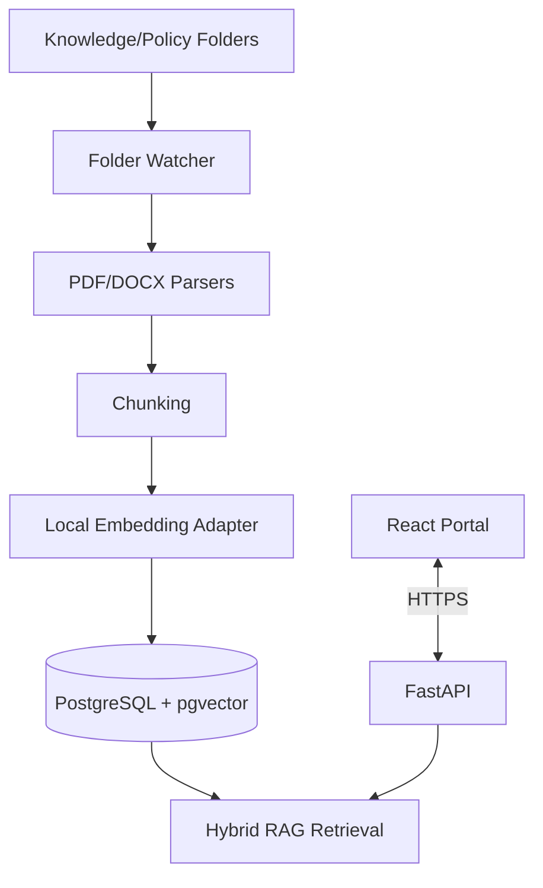

# Phase 5 — Knowledge Ingestion and RAG

**Phase:** 5  
**Status:** Pending  
**Prerequisites:** Phase 4 (Compliance and Forecasting)  
**Master Plan:** [Oracle_Sentinel_AI_Implementation_Plan.md](Oracle_Sentinel_AI_Implementation_Plan.md)

---

## 1. Phase Overview

Build the knowledge ingestion pipeline and RAG (Retrieval-Augmented Generation) retrieval system. This phase enables the platform to ingest PDF and DOCX documents from local folders, parse and chunk them, generate embeddings, store them in pgvector, and retrieve relevant passages with citations for both human search and AI-assisted answers.

## 2. Shared Architecture Context

### 2.1 Non-Negotiable Principles
- **Monitoring never depends on an LLM.** Collection, rules, incidents, and alerts continue if AI is disabled.
- **No custom agent on target Oracle Windows servers** for baseline Oracle monitoring.
- **Read-only by default:** `GSYSTEM` is a local Oracle monitoring user, not a superuser.
- **Deny by default:** RBAC, per-database entitlements, named tool allowlists, bounded queries.
- **Evidence over confidence:** Link explanations to query results, event IDs, and versioned document citations.
- **Oracle licensing matters:** No AWR/ASH/ADDM unless explicitly licensed.
- **Extensibility:** Oracle-specific SQL stays inside `adapters/oracle`, not in core domain models.

### 2.2 Technology Stack

| Layer | Choice |
|---|---|
| Backend | Python 3.14, FastAPI, Pydantic v2 |
| Vector Store | pgvector in PostgreSQL |
| Full-Text Search | PostgreSQL full-text search |
| Document Parsing | PyMuPDF (PDF), python-docx (DOCX) |
| Embeddings | Configurable local embedding adapter |

### 2.3 Architecture Diagram



---

## 3. Deliverables

### 3.1 Backend

#### 3.1.1 Folder Watcher

**`backend/src/sentinel/knowledge/`**:

1. **Scheduled scan** — Detect added/changed/deleted files:
   - SHA-256 hash comparison for change detection
   - Allowlisted extensions: `.pdf`, `.docx`, `.txt`, `.md`
   - File-size and page-count limits
   - Symlink and path traversal protection
   - Parser timeout and extraction quality reporting

2. **Quarantine** — Invalid/unsafe files:
   - Encrypted, corrupt, or unsafe documents are moved to `Quarantine/`
   - Malware scan if available
   - Quarantine log with reason

3. **Knowledge intake structure**:
   ```
   knowledge-intake/
   ├── Knowledge/
   │   ├── oracle-admin-guide.pdf
   │   ├── troubleshooting-ora-errors.docx
   │   └── internal-runbooks/
   │       └── ora-00257.md
   ├── Policy/
   │   ├── database-configuration-standards.pdf
   │   └── data-retention-policy.docx
   └── Quarantine/
   ```

#### 3.1.2 Document Parsers

1. **PDF parser** — Using PyMuPDF:
   - Extract text with page numbers
   - Handle scanned PDFs explicitly (OCR optional and restricted)
   - Preserve headings and section structure

2. **DOCX parser** — Using python-docx:
   - Extract text with headings and tables
   - Preserve section structure

3. **Text/Markdown parser** — Preserve sections and formatting

#### 3.1.3 Chunking

1. **Chunk by headings/sections** — Preserve document structure
2. **Modest overlap** — Ensure context continuity
3. **Parent links** — Maintain reference to parent document
4. **Page/section references** — Preserve citation information

#### 3.1.4 Local Embedding Adapter

1. **Embedding provider** — Protocol/ABC contract:
   ```python
   class EmbeddingProvider(Protocol):
       async def embed_documents(self, texts: list[str]) -> list[list[float]]: ...
       async def embed_query(self, text: str) -> list[float]: ...
   ```

2. **Local embeddings by default** — Sensitive documents embedded locally
3. **Remote embeddings** — Only when explicitly approved with privacy disclosure

#### 3.1.5 Hybrid RAG Retrieval

1. **Vector search** — pgvector similarity search
2. **Full-text search** — PostgreSQL tsvector keyword search
3. **Hybrid fusion** — Combine vector and keyword results
4. **Entitlement filtering** — Filter by caller permissions before sending passages to model
5. **Optional rerank** — Improve result quality
6. **Citations** — Attach document, page, and section references

#### 3.1.6 Document Versioning and ACL

1. **Versioning** — SHA-256 hashes and version tracking
2. **Classification** — `Knowledge` or `Policy` category
3. **ACL** — Document-level access control
4. **Deletion/reindexing** — Handle document removal and permission changes

#### 3.1.7 Persistence

**`backend/src/sentinel/persistence/`** — New SQLAlchemy models:

| Table | Important Fields |
|---|---|
| `documents` | ID, path, category, hash, version, ingestion status, ACL, timestamps |
| `document_chunks` | document ID/version, chunk index, page/heading, content, embedding vector, tsvector, ACL |

- Alembic migrations for new tables
- pgvector extension setup

#### 3.1.8 API Endpoints

**`backend/src/sentinel/api/v1/`**:

| Method | Path | Description |
|---|---|---|
| `GET` | `/api/v1/knowledge/documents` | Search/list authorized indexed documents |
| `POST` | `/api/v1/knowledge/reindex` | Admin-only reindex request |
| `POST` | `/api/v1/knowledge/search` | Search with hybrid retrieval |

### 3.2 Frontend

#### 3.2.1 Knowledge Page

- **Approved docs list** — Table showing:
  - Document name, category, version
  - Ingestion status
  - Last indexed timestamp

- **Search** — Full-text search with:
  - Document excerpts
  - Page/section citations
  - Source links

#### 3.2.2 No-LLM Document Search

- Keyword/vector search with document excerpts and source links
- Works without LLM enabled

### 3.3 Infrastructure

- **Knowledge intake folders** — `knowledge-intake/` with Knowledge/, Policy/, Quarantine/
- **Embedding configuration** — Local embedding model settings
- **pgvector extension** — PostgreSQL extension for vector storage

---

## 4. Acceptance Criteria

- [ ] New/changed/deleted docs are reflected in the index
- [ ] Search displays document + page/section citations
- [ ] Unauthorized docs never appear in search results
- [ ] Corrupted docs are quarantined
- [ ] No-LLM document search works
- [ ] Retrieval test dataset passes chosen thresholds (Recall@k, nDCG)
- [ ] Document versioning works correctly
- [ ] ACL filtering prevents unauthorized access

---

## 5. Tests

### 5.1 Unit Tests
- **PDF/DOCX parsing** — Test extraction with sample documents
- **Chunking** — Test chunk boundaries and overlap
- **Embedding** — Test embedding generation and dimensions
- **Hybrid retrieval** — Test vector + keyword fusion

### 5.2 Integration Tests
- **New/changed/deleted docs** — Verify folder watcher detects changes
- **Unauthorized docs** — Verify ACL filtering
- **Corrupted docs** — Verify quarantine behavior
- **No-LLM search** — Verify search works without LLM

### 5.3 Edge Cases
- **Scanned PDFs** — Verify graceful handling
- **Large documents** — Verify file-size limits
- **Path traversal** — Verify security protections
- **Malformed documents** — Verify quarantine

### 5.4 Evaluation Tests
- **Recall@k** — Measure retrieval quality
- **nDCG** — Measure result ranking quality
- **Cited-answer groundedness** — Verify citations are accurate

---

## 6. Dependencies

### Python (additional to Phase 4)
```toml
[project]
dependencies = [
    "pymupdf>=1.24",        # PDF parsing
    "python-docx>=1.1",     # DOCX parsing
    "pgvector>=0.2",        # pgvector integration
]
```

---

## 7. Key Files to Create

| File | Description |
|---|---|
| `backend/src/sentinel/knowledge/__init__.py` | Knowledge package |
| `backend/src/sentinel/knowledge/watcher.py` | Folder watcher |
| `backend/src/sentinel/knowledge/parsers.py` | PDF/DOCX parsers |
| `backend/src/sentinel/knowledge/chunker.py` | Document chunking |
| `backend/src/sentinel/knowledge/embeddings.py` | Embedding adapter |
| `backend/src/sentinel/knowledge/retrieval.py` | Hybrid RAG retrieval |
| `backend/src/sentinel/knowledge/quarantine.py` | Quarantine handling |
| `backend/src/sentinel/api/v1/knowledge.py` | Knowledge endpoints |
| `backend/src/sentinel/persistence/models.py` | Add document models |
| `backend/tests/knowledge/test_parsers.py` | Parser tests |
| `backend/tests/knowledge/test_retrieval.py` | Retrieval tests |
| `frontend/src/features/knowledge/` | Knowledge page |
| `knowledge-intake/README.md` | Knowledge intake docs |

---

## 8. Risks

- **Document parsing quality** — Scanned PDFs may not extract well. Mitigation: quarantine low-quality extractions.
- **Embedding model choice** — Model quality affects retrieval. Mitigation: evaluation fixtures and configurable model.
- **Data volume** — Large document sets can slow retrieval. Mitigation: indexing and caching.
- **Sensitive documents** — Ensure proper ACL and embedding privacy. Mitigation: local embeddings by default.

---

## 9. Cross-References

- **Master Plan:** [Oracle_Sentinel_AI_Implementation_Plan.md](Oracle_Sentinel_AI_Implementation_Plan.md)
- **Previous Phase:** [Phase 4 — Compliance and Forecasting](Phase_4_Compliance_Forecasting.md)
- **Next Phase:** [Phase 6 — AI Copilot](Phase_6_AI_Copilot.md)
