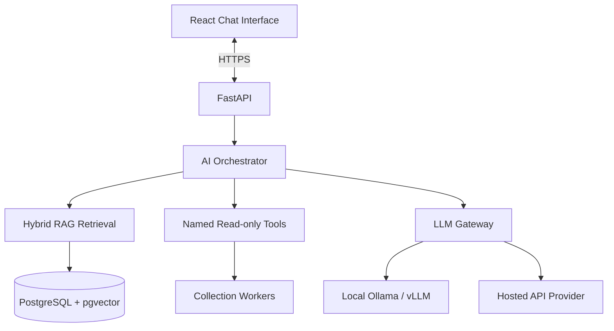

# Phase 6 — AI Copilot with LLM Gateway

**Phase:** 6  
**Status:** Implemented. Automated checks pass on SQLite. The portal was verified with AI disabled. Live Ollama, a hosted model API, and live Oracle were not called.<br>
**Prerequisites:** Phase 5 (Knowledge and RAG)  
**Master Plan:** [Oracle_Sentinel_AI_Implementation_Plan.md](Oracle_Sentinel_AI_Implementation_Plan.md)

---

## 1. Phase Overview

Build the configurable LLM gateway, named read-only tools, AI orchestrator with deterministic workflow, and chat interface with RAG citations. This phase enables the platform to provide an AI-assisted DBA copilot that can answer questions about database health, incidents, and knowledge base documents using grounded, cited responses.

## 2. Shared Architecture Context

### 2.1 Non-Negotiable Principles
- **Monitoring never depends on an LLM.** Collection, rules, incidents, and alerts continue if AI is disabled.
- **No custom agent on target Oracle Windows servers** for baseline Oracle monitoring.
- **Read-only by default:** `GSYSTEM` is a local Oracle monitoring user, not a superuser.
- **Deny by default:** RBAC, per-database entitlements, named tool allowlists, bounded queries.
- **Evidence over confidence:** Link explanations to query results, event IDs, and versioned document citations.
- **Oracle licensing matters:** No AWR/ASH/ADDM unless explicitly licensed.
- **Extensibility:** Oracle-specific SQL stays inside `adapters/oracle`, not in core domain models.

### 2.2 Technology Stack

| Layer | Choice |
|---|---|
| Backend | Python 3.14, FastAPI, Pydantic v2 |
| Local LLM | Ollama (dev), vLLM (production) |
| Hosted LLM | Configurable provider adapter |
| Agent Orchestration | Deterministic Python workflow (LangGraph if Python 3.14 compatible) |

### 2.3 Architecture Diagram



---

## 3. Deliverables

### 3.1 Backend

#### 3.1.1 Provider Gateway

**`backend/src/sentinel/ai/`**:

1. **Provider abstraction**:
   ```python
   class ChatModelProvider(Protocol):
       async def generate(self, messages: list[dict], *, tools: list[dict] | None,
                          structured_schema: dict | None, correlation_id: str) -> dict: ...
       async def health(self) -> dict: ...
   ```

2. **Provider implementations**:
   - `LocalChatProvider` — Ollama integration
   - `HostedChatProvider` — API key-based provider
   - `DisabledChatProvider` — No-op provider for no-LLM mode

3. **Gateway** — Provider selection and routing:
   - Configurable default provider (local/hosted/disabled)
   - Fallback policy — never auto-failover to hosted
   - Timeouts and token limits
   - Provider health checking

4. **Configuration**:
   ```yaml
   ai:
     enabled: true
     default_provider: local              # local | hosted | disabled
     fallback_provider: disabled          # never silently send sensitive data to cloud
     timeouts_seconds: 45
     max_tool_calls: 5
     max_context_tokens: 12000
     require_citations: true
     redact_sensitive_telemetry: true
     local:
       api_base: http://ollama:11434
       model: configurable
     hosted:
       provider: configurable
       api_base: null
       model: configurable
       api_key_secret_ref: secret://sentinel/llm_api_key
   ```

#### 3.1.2 Named Read-Only Tools

**`backend/src/sentinel/ai/tools/`**:

1. **Tool registry** — Allowlisted read-only tools:
   - `get_database_health(database_id)` — Current observation summary
   - `get_tablespace_status(database_id, tablespace_name)` — Tablespace metrics
   - `get_fra_status(database_id)` — FRA usage and archive state
   - `get_events(database_id, filters)` — Recent diagnostic events
   - `get_compliance(database_id)` — Compliance policy results
   - `search_knowledge(query)` — RAG knowledge search

2. **Tool contracts** — Typed, validated operations:
   - Never expose `execute_sql(query: str)` to the LLM
   - All tools have bounded queries and short timeouts
   - Results are validated and sanitized

3. **Authorization** — Per-tool and per-target authorization:
   - Recheck backend authorization regardless of UI state
   - Restrict to caller's entitled databases

#### 3.1.3 AI Orchestrator

**`backend/src/sentinel/ai/orchestrator.py`**:

1. **Deterministic workflow**:
   - **Intent router** — Classify question vs health report vs incident investigation vs operation proposal
   - **Diagnostic coordinator** — Choose allowlisted named tools with small budgets and timeouts
   - **Evidence collector** — Execute authorized read-only health/diagnostic tools and retrieve prior incidents
   - **Knowledge retriever** — Fetch authorized RAG passages
   - **Analysis composer** — Produce cited assessment, confidence/limitations, and next steps
   - **Policy guard** — Check authorization/tool lists and block forbidden actions

2. **Stateful workflow** — LangGraph (if compatible) or equivalent finite-state workflow
3. **Limits** — Bound loops, tool calls, output size, and execution time
4. **Prompt injection defense** — Ignore instructions found inside log lines or runbooks that ask the model to bypass safeguards

#### 3.1.4 Safety Policy

**`backend/src/sentinel/ai/safety.py`**:

1. **Tool allowlist enforcement** — Only registered tools can be called
2. **Prompt injection defense** — Sanitize all inputs from logs, SQL results, and documents
3. **Structured output validation** — Pydantic validation of model outputs
4. **Data classification** — Log which provider and data classification each request used
5. **Fail closed** — If hosted egress is forbidden, fail closed

#### 3.1.5 Persistence

**`backend/src/sentinel/persistence/`** — New SQLAlchemy models:

| Table | Important Fields |
|---|---|
| `chat_threads` | UUID, user, scope, provider/model/version, created_at |
| `chat_messages` | thread UUID, role, content, tool trace refs, citation refs, token/cost metadata |
| `tool_executions` | user/agent, target, tool id, validated args, timings, result digest, authorization decision |

- Alembic migrations for new tables

#### 3.1.6 API Endpoints

**`backend/src/sentinel/api/v1/`**:

| Method | Path | Description |
|---|---|---|
| `POST` | `/api/v1/chat/threads` | Create a scoped chat |
| `POST` | `/api/v1/chat/threads/{id}/messages` | Submit message; stream via SSE |
| `GET` | `/api/v1/chat/threads/{id}/messages` | Get chat history |
| `GET` | `/api/v1/admin/ai/providers` | Provider health and config summary |

### 3.2 Frontend

#### 3.2.1 DBA Copilot Chat Page

- **Embedded chat** — Globally accessible and context-aware (selected DB/incident scope)
- **Source citations** — Display document and metric citations with links
- **Tool execution transcript** — Show safe summaries of tool calls
- **Model provider badge** — Show which provider is being used
- **No-LLM fallback** — Guided commands and document search when LLM is disabled

#### 3.2.2 Context-Aware Chat

- **Database scope** — Chat scoped to selected database
- **Incident scope** — Chat scoped to selected incident
- **Guided commands** — Pre-defined commands when LLM is disabled

### 3.3 Infrastructure

- **Ollama configuration** — Local LLM settings
- **Hosted provider configuration** — API key secret reference
- **Model configuration** — Admin page for provider and model selection

---

## 4. Acceptance Criteria

- [x] Same test prompt works through local test provider and hosted-provider mock
- [x] API keys are secret-referenced, never hardcoded
- [x] LLM outage does not break monitoring
- [x] Injection tests cannot force unauthorized tool calls
- [x] Queries cite sources and evidence
- [x] No-LLM fallback provides guided commands and document search
- [x] Tool execution is audited and authorized
- [x] Model provider badge is displayed in chat

---

## 5. Tests

### 5.1 Unit Tests
- **Provider gateway** — Test provider selection and routing
- **Named tools** — Test each tool returns expected results
- **Orchestrator** — Test deterministic workflow steps
- **Safety policy** — Test injection defense and tool allowlist

### 5.2 Integration Tests
- **Local and hosted provider** — Test both provider types
- **Injection tests** — Verify prompt injection cannot bypass safeguards
- **No-LLM fallback** — Verify guided commands work
- **Citation verification** — Verify citations are accurate

### 5.3 Security Tests
- **Unauthenticated tools** — Verify tools require authentication
- **Cross-target access** — Verify tools respect target permissions
- **LLM trying forbidden tools** — Verify forbidden tools are blocked
- **Exfiltration to hosted provider** — Verify sensitive data is not sent to cloud

### 5.4 Edge Cases
- **LLM timeout** — Verify graceful handling
- **Tool failure** — Verify error handling
- **Empty RAG results** — Verify graceful handling

---

## 6. Dependencies

### Python (additional to Phase 5)
```toml
[project]
dependencies = [
    "ollama>=0.1",            # Ollama client (optional)
]
```

---

## 7. Key Files to Create

| File | Description |
|---|---|
| `backend/src/sentinel/ai/__init__.py` | AI package |
| `backend/src/sentinel/ai/providers/__init__.py` | Provider implementations |
| `backend/src/sentinel/ai/providers/local.py` | LocalChatProvider (Ollama) |
| `backend/src/sentinel/ai/providers/hosted.py` | HostedChatProvider |
| `backend/src/sentinel/ai/providers/disabled.py` | DisabledChatProvider |
| `backend/src/sentinel/ai/gateway.py` | Provider gateway |
| `backend/src/sentinel/ai/orchestrator.py` | AI orchestrator |
| `backend/src/sentinel/ai/tools/__init__.py` | Named tools |
| `backend/src/sentinel/ai/tools/registry.py` | Tool registry |
| `backend/src/sentinel/ai/tools/health.py` | Health tools |
| `backend/src/sentinel/ai/tools/storage.py` | Storage tools |
| `backend/src/sentinel/ai/tools/knowledge.py` | Knowledge tools |
| `backend/src/sentinel/ai/safety.py` | Safety policy |
| `backend/src/sentinel/api/v1/chat.py` | Chat endpoints |
| `backend/src/sentinel/persistence/models.py` | Add chat models |
| `backend/tests/ai/test_gateway.py` | Gateway tests |
| `backend/tests/ai/test_tools.py` | Tool tests |
| `backend/tests/ai/test_safety.py` | Safety tests |
| `frontend/src/features/chat/` | DBA Copilot Chat page |

---

## 8. Risks

- **LangGraph Python 3.14 compatibility** — Native extension build failures reported. Mitigation: isolate behind interface, use deterministic workflows.
- **LLM quality** — Model quality affects answer quality. Mitigation: evaluation fixtures and configurable model.
- **Prompt injection** — Malicious content in logs or docs. Mitigation: safety policy and input sanitization.
- **Token limits** — Large contexts may exceed model limits. Mitigation: bounded context and truncation.

---

## 9. Cross-References

- **Master Plan:** [Oracle_Sentinel_AI_Implementation_Plan.md](Oracle_Sentinel_AI_Implementation_Plan.md)
- **Previous Phase:** [Phase 5 — Knowledge and RAG](Phase_5_Knowledge_RAG.md)
- **Next Phase:** [Phase 7 — Operations, Auth, and Audit](Phase_7_Operations_Auth_Audit.md)
