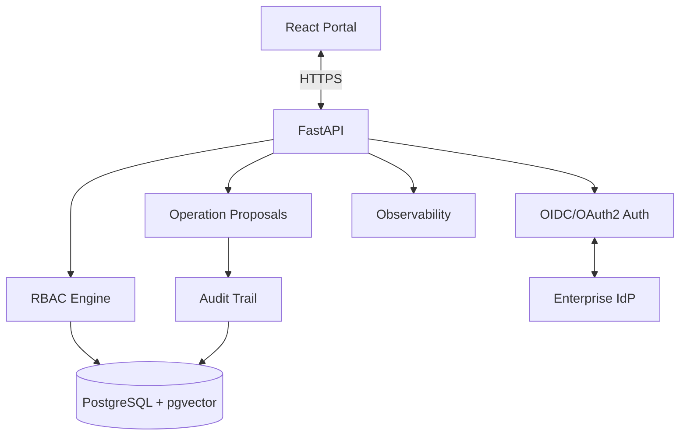

# Phase 7 — Operation Proposals, Auth, and Audit

**Phase:** 7  
**Status:** Implemented  
**Prerequisites:** Phase 6 (AI Copilot)  
**Master Plan:** [Oracle_Sentinel_AI_Implementation_Plan.md](Oracle_Sentinel_AI_Implementation_Plan.md)

---

## 1. Phase Overview

Build operation proposals (proposal-only, no auto-DDL), OIDC/OAuth2 authentication, RBAC roles, audit trails, and production hardening. This phase enables the platform to propose database changes for human approval, enforce role-based access control, and maintain immutable audit records for compliance.

## 2. Shared Architecture Context

### 2.1 Non-Negotiable Principles
- **Monitoring never depends on an LLM.** Collection, rules, incidents, and alerts continue if AI is disabled.
- **No custom agent on target Oracle Windows servers** for baseline Oracle monitoring.
- **Read-only by default:** `GSYSTEM` is a local Oracle monitoring user, not a superuser.
- **Deny by default:** RBAC, per-database entitlements, named tool allowlists, bounded queries.
- **Evidence over confidence:** Link explanations to query results, event IDs, and versioned document citations.
- **Oracle licensing matters:** No AWR/ASH/ADDM unless explicitly licensed.
- **Extensibility:** Oracle-specific SQL stays inside `adapters/oracle`, not in core domain models.

### 2.2 Technology Stack

| Layer | Choice |
|---|---|
| Backend | Python 3.14, FastAPI, Pydantic v2 |
| Auth | OIDC/OAuth2 with enterprise IdP |
| Observability | Prometheus, OpenTelemetry, structured JSON logging |

### 2.3 Architecture Diagram



---

## 3. Deliverables

### 3.1 Backend

#### 3.1.1 Operation Proposals

**`backend/src/sentinel/operations/`**:

1. **Proposal generation** — Structured proposals for database changes:
   - `tablespace.add_omf_datafile` — Add datafile to tablespace
   - Other operations defined by typed schemas

2. **Validation/preflight** — Before proposal creation:
   - Exact target database, PDB, tablespace, requested size
   - Allowable limits and maintenance restrictions
   - Storage availability check
   - OMF/non-OMF detection

3. **Change preview** — Dry-run plan:
   - Shows intended SQL and impact
   - Generated SQL uses fixed templates + allowlisted identifiers
   - Never model-concatenated text

4. **Approval workflow**:
   - DBA/operations approval with expiry
   - Separation of duties as required
   - Proposal-only in Release 1 — **no execution**

5. **Audit trail** — Immutable record:
   - Requester, action, target, parameters
   - Risk assessment, approval/expiry/status
   - Execution log (when execution is enabled)

#### 3.1.2 OIDC/OAuth2 Authentication

**`backend/src/sentinel/auth/`**:

1. **OIDC authentication** — Enterprise IdP integration:
   - Standard OIDC/OAuth2 flow
   - Backend-issued validated identity
   - Development-mode local identity for testing

2. **RBAC roles**:
   - `viewer` — Read-only access to dashboards
   - `operator` — Acknowledge incidents, view proposals
   - `dba` — Create proposals, manage databases
   - `platform_admin` — Full platform administration
   - `security_auditor` — Read-only access to audit trails

3. **Per-database entitlements** — Environment-based access:
   - Users are entitled to specific databases/environments
   - Entitlements checked at API and service layer

#### 3.1.3 Audit Trails

**`backend/src/sentinel/observability/`**:

1. **Immutable audit events**:
   - Timestamp, user/service, action, target
   - Correlation ID, outcome, evidence digest
   - Tamper-evident storage

2. **Observability**:
   - Prometheus metrics
   - Structured JSON logging
   - OpenTelemetry integration

3. **Data lifecycle**:
   - Retention policies for raw logs, time-series samples, incidents, chats, audit, and documents
   - Partitioning for high-volume observations/events
   - Backup and restore procedures

#### 3.1.4 Persistence

**`backend/src/sentinel/persistence/`** — New SQLAlchemy models:

| Table | Important Fields |
|---|---|
| `operation_proposals` | UUID, requester, action, target, parameters, risk, approval/expiry/status, execution log |
| `audit_events` | immutable timestamp, user/service, action, target, correlation ID, outcome, evidence digest |
| `target_credentials` | target UUID, secret reference (never actual password), rotation timestamp |

- Alembic migrations for new tables

#### 3.1.5 API Endpoints

**`backend/src/sentinel/api/v1/`**:

| Method | Path | Description |
|---|---|---|
| `POST` | `/api/v1/operations/proposals` | Submit constrained operation proposal |
| `GET` | `/api/v1/operations/proposals` | List proposals with filters |
| `GET` | `/api/v1/operations/proposals/{id}` | Proposal detail |
| `POST` | `/api/v1/operations/proposals/{id}/approve` | Approve proposal |
| `POST` | `/api/v1/operations/proposals/{id}/reject` | Reject proposal |
| `GET` | `/api/v1/audit/events` | List audit events |
| `GET` | `/api/v1/admin/ai/providers` | Provider health and config summary |

### 3.2 Frontend

#### 3.2.1 Administration Page

- **Registry/aliases** — Manage registered databases
- **Collector configuration** — Poll profiles and frequencies
- **LLM choice** — Provider and model selection
- **Roles** — User role management
- **Rule thresholds** — Configure monitoring rules
- **Notification policies** — SMTP and escalation settings

#### 3.2.2 Operation Proposal UI

- **Proposal creation** — Form for database change proposals
- **Approval workflow** — Review and approve/reject proposals
- **Proposal history** — List of past proposals with status

#### 3.2.3 Authentication Flow

- **Login** — OIDC/OAuth2 login page
- **Role-based UI rendering** — Show/hide features based on role
- **Session management** — Token refresh and logout

### 3.3 Infrastructure

- **OIDC configuration** — IdP settings and client credentials
- **TLS configuration** — Certificate management
- **Secret rotation** — Credential rotation procedures
- **Load tests** — Performance testing under expected load
- **Security test suite** — Comprehensive security tests

---

## 4. Acceptance Criteria

- [x] `Extend USERS by 10 GB` cannot mutate a real database in Release 1
- [x] Change is visible as pending proposal
- [x] Unapproved/expired requests are denied
- [x] Permissions verified at API and service layer
- [x] Full audit trail is immutable
- [x] RBAC roles are enforced correctly
- [x] OIDC authentication works with an enterprise IdP metadata flow. A live IdP was not connected; tests use a mocked IdP. Local sign-in remains when the IdP is down.
- [ ] Load tests pass under an agreed production fleet size. A 25-call proposal-list check is in the unit suite. It is not a production load run.
- [x] Security tests cover unauthorized roles, refused execution, audit tamper, and secret references. A restore drill against the application database was not run.

---

## 5. Tests

### 5.1 Unit Tests
- **Proposal workflow** — Test proposal creation, validation, and approval
- **RBAC enforcement** — Test role-based access control
- **Audit trail** — Test audit event creation and immutability
- **OIDC authentication** — Test authentication flow with mock IdP

### 5.2 Integration Tests
- **Proposal-only workflow** — Verify no execution in Release 1
- **RBAC at API layer** — Verify permissions at API endpoints
- **Audit trail immutability** — Verify audit events cannot be modified
- **Load tests** — Verify performance under load

### 5.3 Security Tests
- **Unauthorized access** — Verify RBAC prevents unauthorized actions
- **Proposal execution** — Verify proposals cannot be auto-executed
- **Audit tampering** — Verify audit trail cannot be tampered with
- **Credential handling** — Verify secrets are properly managed

### 5.4 Edge Cases
- **Expired proposals** — Verify expired proposals are denied
- **Concurrent approvals** — Verify race conditions are handled
- **IdP outage** — Verify graceful degradation

---

## 6. Dependencies

### Python (additional to Phase 6)
```toml
[project]
dependencies = [
    "authlib>=1.3",          # OIDC/OAuth2
    "prometheus-client>=0.20",  # Prometheus metrics
    "opentelemetry-api>=1.24",  # OpenTelemetry
]
```

---

## 7. Key Files to Create

| File | Description |
|---|---|
| `backend/src/sentinel/operations/__init__.py` | Operations package |
| `backend/src/sentinel/operations/proposals.py` | Proposal generation |
| `backend/src/sentinel/operations/validation.py` | Proposal validation |
| `backend/src/sentinel/operations/approval.py` | Approval workflow |
| `backend/src/sentinel/auth/__init__.py` | Auth package |
| `backend/src/sentinel/auth/oidc.py` | OIDC authentication |
| `backend/src/sentinel/auth/rbac.py` | RBAC engine |
| `backend/src/sentinel/observability/__init__.py` | Observability package |
| `backend/src/sentinel/observability/audit.py` | Audit trail |
| `backend/src/sentinel/observability/metrics.py` | Prometheus metrics |
| `backend/src/sentinel/api/v1/operations.py` | Operation endpoints |
| `backend/src/sentinel/api/v1/audit.py` | Audit endpoints |
| `backend/src/sentinel/persistence/models.py` | Add operation/audit models |
| `backend/tests/operations/test_proposals.py` | Proposal tests |
| `backend/tests/auth/test_rbac.py` | RBAC tests |
| `backend/tests/observability/test_audit.py` | Audit tests |
| `frontend/src/features/admin/` | Administration page |
| `frontend/src/features/operations/` | Operation proposal UI |
| `frontend/src/features/auth/` | Authentication flow |

---

## 8. Risks

- **OIDC integration complexity** — Enterprise IdP may have custom requirements. Mitigation: standard OIDC flow first.
- **RBAC granularity** — Per-database entitlements add complexity. Mitigation: clear entitlement model.
- **Audit volume** — High-volume audit events can impact performance. Mitigation: partitioning and retention.
- **Proposal-only limitation** — Users may expect auto-execution. Mitigation: clear documentation and UI messaging.

---

## 9. Cross-References

- **Master Plan:** [Oracle_Sentinel_AI_Implementation_Plan.md](Oracle_Sentinel_AI_Implementation_Plan.md)
- **Previous Phase:** [Phase 6 — AI Copilot](Phase_6_AI_Copilot.md)
- **Next Phase:** [Phase 8 — Privileged Operations](Phase_8_Privileged_Operations.md)
