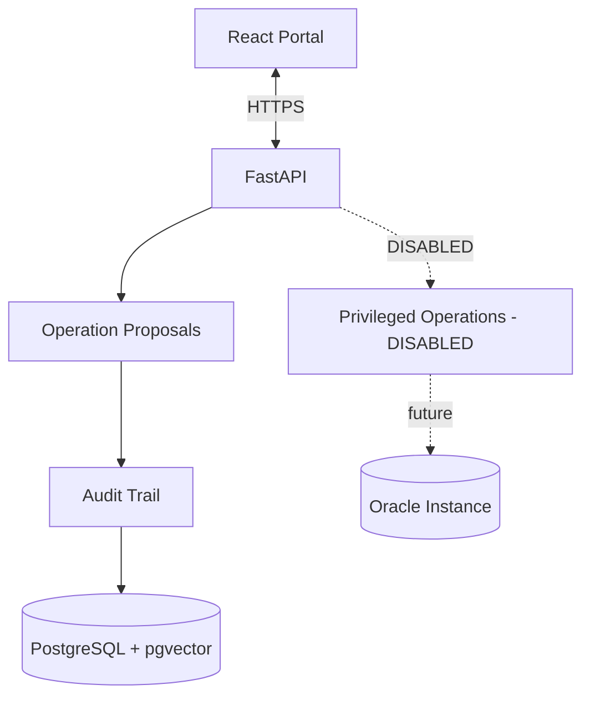

# Phase 8 — Privileged Operations (Placeholder)

**Phase:** 8  
**Status:** Pending  
**Prerequisites:** Phase 7 (Operations, Auth, and Audit)  
**Master Plan:** [Oracle_Sentinel_AI_Implementation_Plan.md](Oracle_Sentinel_AI_Implementation_Plan.md)

---

## 1. Phase Overview

Create a privileged operations interface placeholder that is **disabled by default**. This phase provides the skeleton for future privileged operation execution after independent security/DBA review, but does not enable any execution capability in Release 1. This ensures the architecture is ready for future extension while maintaining the security principle of proposal-only operations in Release 1.

## 2. Shared Architecture Context

### 2.1 Non-Negotiable Principles
- **Monitoring never depends on an LLM.** Collection, rules, incidents, and alerts continue if AI is disabled.
- **No custom agent on target Oracle Windows servers** for baseline Oracle monitoring.
- **Read-only by default:** `GSYSTEM` is a local Oracle monitoring user, not a superuser.
- **Deny by default:** RBAC, per-database entitlements, named tool allowlists, bounded queries.
- **Evidence over confidence:** Link explanations to query results, event IDs, and versioned document citations.
- **Oracle licensing matters:** No AWR/ASH/ADDM unless explicitly licensed.
- **Extensibility:** Oracle-specific SQL stays inside `adapters/oracle`, not in core domain models.

### 2.2 Technology Stack

| Layer | Choice |
|---|---|
| Backend | Python 3.14, FastAPI, Pydantic v2 |
| Privileged Operations | Disabled by default |

### 2.3 Architecture Diagram



---

## 3. Deliverables

### 3.1 Backend

#### 3.1.1 Privileged Operations Interface Placeholder

**`backend/src/sentinel/operations/`** (privileged sub-module):

1. **Disabled by default**:
   - `OPERATIONS_EXECUTION_ENABLED=false` in configuration
   - All execution endpoints return HTTP 501 Not Implemented when disabled
   - Clear error message indicating privileged operations are disabled

2. **Approval workflow skeleton**:
   - Interface for future approval workflow
   - Separation of duties structure
   - Pre-flight check placeholders

3. **No execution capability**:
   - No DDL execution
   - No direct shell, RMAN, SQL*Plus, or generic SQL
   - No filesystem deletion or OS commands
   - No privileged credential access

4. **Audit trail integration**:
   - All attempts to access privileged operations are audited
   - Clear indication that operations are disabled

#### 3.1.2 Configuration

```yaml
operations:
  execution_enabled: false    # Disabled by default in Release 1
  require_dual_approval: true  # Future: require two approvers
  approval_expiry_hours: 24    # Future: approval validity period
```

#### 3.1.3 Persistence

**`backend/src/sentinel/persistence/`** — New SQLAlchemy models:

| Table | Important Fields |
|---|---|
| `privileged_operations` | UUID, proposal UUID, status, approver, execution_log, created_at |

- Alembic migration for new table
- Table exists but is never written to when disabled

#### 3.1.4 API Endpoints

**`backend/src/sentinel/api/v1/`**:

| Method | Path | Description |
|---|---|---|
| `GET` | `/api/v1/operations/privileged` | List privileged operations (disabled) |
| `POST` | `/api/v1/operations/privileged/{id}/execute` | Execute operation (disabled) |

- All endpoints return HTTP 501 when `OPERATIONS_EXECUTION_ENABLED=false`
- Audit event logged for each attempt

### 3.2 Frontend

#### 3.2.1 Privileged Operations UI Placeholder

- **Disabled state** — UI shows privileged operations are disabled
- **Clear messaging** — "Privileged operations are disabled in Release 1"
- **No execution buttons** — No way to trigger execution from UI

### 3.3 Infrastructure

- **Security review documentation** — Template for future security/DBA review
- **Integration test database** — Plan for dedicated test database
- **Rollback plan** — Template for rollback procedures

---

## 4. Acceptance Criteria

- [ ] Privileged operations are disabled by default
- [ ] No execution is possible through API or UI
- [ ] Attempts to access privileged operations are audited
- [ ] Clear error messages indicate operations are disabled
- [ ] Configuration flag controls enabled/disabled state
- [ ] Security review documentation is in place
- [ ] No privileged credentials are provisioned

---

## 5. Tests

### 5.1 Unit Tests
- **Disabled-by-default verification** — Verify operations are disabled
- **Configuration flag** — Verify flag controls enabled/disabled state
- **Audit logging** — Verify attempts are audited

### 5.2 Integration Tests
- **API endpoints** — Verify HTTP 501 when disabled
- **No execution** — Verify no DDL can be executed
- **Audit trail** — Verify audit events are created

### 5.3 Security Tests
- **Unauthorized access** — Verify RBAC prevents access
- **Configuration tampering** — Verify flag cannot be bypassed
- **Credential access** — Verify no privileged credentials are accessible

### 5.4 Edge Cases
- **Configuration change** — Verify enabling requires explicit approval
- **Concurrent requests** — Verify race conditions are handled
- **Audit overflow** — Verify audit events are handled

---

## 6. Dependencies

### Python (additional to Phase 7)
```toml
# No new dependencies
```

---

## 7. Key Files to Create

| File | Description |
|---|---|
| `backend/src/sentinel/operations/privileged/__init__.py` | Privileged operations package |
| `backend/src/sentinel/operations/privileged/interface.py` | Privileged operations interface |
| `backend/src/sentinel/operations/privileged/disabled.py` | Disabled implementation |
| `backend/src/sentinel/api/v1/privileged.py` | Privileged operation endpoints |
| `backend/src/sentinel/persistence/models.py` | Add privileged operation model |
| `backend/tests/operations/test_privileged.py` | Privileged operation tests |
| `frontend/src/features/privileged/` | Privileged operations UI placeholder |
| `docs/privileged-operations-security-review.md` | Security review template |

---

## 8. Risks

- **Accidental enablement** — Privileged operations could be accidentally enabled. Mitigation: explicit configuration flag and audit logging.
- **Security review delay** — Future security review may take time. Mitigation: clear documentation and templates.
- **User expectation** — Users may expect privileged operations to work. Mitigation: clear UI messaging and documentation.

---

## 9. Future Considerations

Privileged operation execution may be considered only after:
1. Independent security/DBA review
2. Separate service and narrow privilege/definer-rights interface
3. Preflight checks and approvals
4. Rollback plan where technically feasible
5. Dedicated integration test database
6. Full auditing and monitoring

**Do not include as enabled-by-default Release 1 behavior.**

---

## 10. Cross-References

- **Master Plan:** [Oracle_Sentinel_AI_Implementation_Plan.md](Oracle_Sentinel_AI_Implementation_Plan.md)
- **Previous Phase:** [Phase 7 — Operations, Auth, and Audit](Phase_7_Operations_Auth_Audit.md)
- **Privileged Operations SQL:** [Oracle_Sentinel_Optional_Privileged_Operations.sql](Oracle_Sentinel_Optional_Privileged_Operations.sql)
