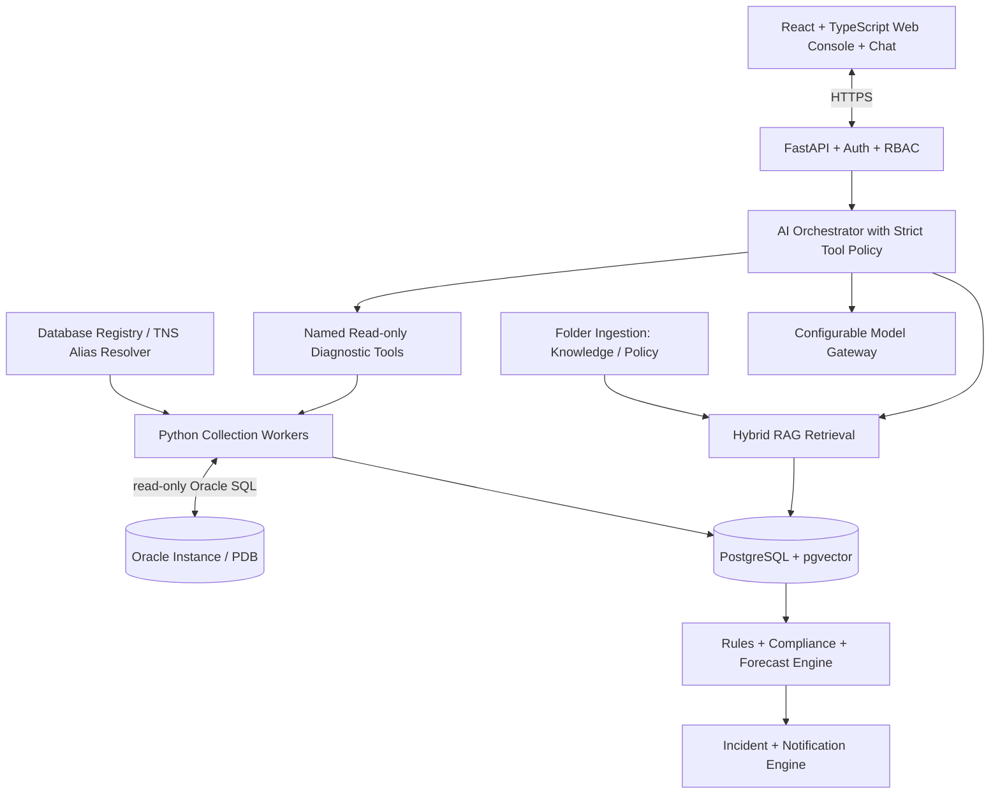

# Oracle Sentinel AI — Architecture

## Overview

Oracle Sentinel AI is a central, browser-based platform for monitoring registered Oracle databases on Windows Server without installing a custom agent on each database server.

## Technology Stack

| Layer | Choice |
|---|---|
| Backend | Python 3.14, FastAPI, Pydantic v2 |
| Oracle Driver | python-oracledb (thin mode) |
| Frontend | TypeScript + React, Vite |
| Application DB | PostgreSQL + pgvector |
| Scheduler | APScheduler (early) → Celery + Redis |
| Local LLM | Ollama (dev), vLLM (production) |
| Auth | OIDC/OAuth2 with enterprise IdP |
| Notifications | SMTP initially |

## Architecture Diagram

## Non-Negotiable Principles

- **Monitoring never depends on an LLM** — collection, rules, incidents continue if AI is disabled
- **No custom agent on target servers** for baseline Oracle monitoring
- **Read-only by default** — GSYSTEM is a local monitoring user, not a superuser
- **Deny by default** — RBAC, per-database entitlements, named tool allowlists, bounded queries
- **Evidence over confidence** — link explanations to query results, event IDs, and document citations
- **Oracle licensing matters** — no AWR/ASH/ADDM unless explicitly licensed
- **Extensibility** — Oracle-specific SQL stays inside `adapters/oracle`
