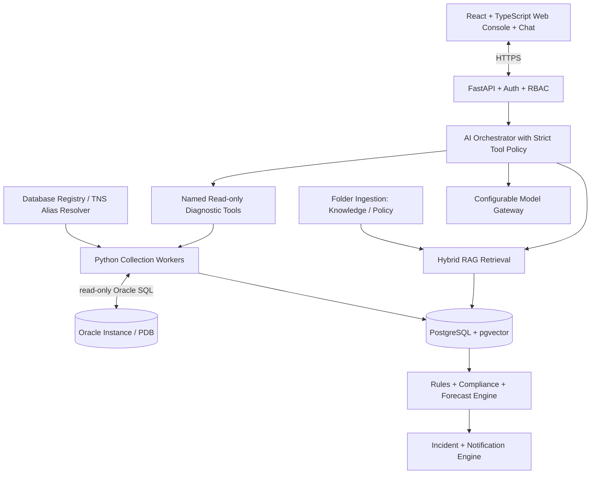

# Oracle Sentinel AI — Architecture

## Overview

Oracle Sentinel AI is a central, browser-based platform for monitoring registered Oracle databases on Windows Server without installing a custom agent on each database server.

## Technology Stack

| Layer | Choice |
|---|---|
| Backend | Python 3.14, FastAPI, Pydantic v2 |
| Oracle Driver | python-oracledb (thin mode) |
| Frontend | TypeScript + React, Vite |
| Application DB | PostgreSQL + pgvector |
| Scheduler | APScheduler (early) → Celery + Redis |
| Local LLM | Ollama (dev), vLLM (production) |
| Auth | OIDC/OAuth2 with enterprise IdP |
| Notifications | SMTP initially |

## Architecture Diagram

## Knowledge ingestion

Approved files in `knowledge-intake/Knowledge` and `knowledge-intake/Policy` are parsed, chunked, embedded locally, and stored in PostgreSQL. Search combines pgvector similarity with full-text ranking and returns a document, version, page, and section citation. Callers only receive passages their ACL allows. Collection, rules, incidents, and alerts do not call this pipeline and do not require a language model. Remote embeddings are used only when explicitly approved with a privacy disclosure.

## Copilot

The copilot answers from collected application data, approved documents, and a fixed set of read-only database readings. A deterministic workflow chooses the tools. The language model does not choose tools, and it never receives a SQL execution tool. Database questions about availability, errors, space, growth, performance, blocking, SQL, memory, backups, Data Guard, accounts, and jobs are sent to the local readings MCP server (`python -m sentinel.mcp`). That server accepts a TNS alias and runs one named reading; it does not accept SQL. The model only explains the rows. Fleet chat does not open that connection. Local Ollama and an approved hosted provider are separate clients. A local failure does not call the hosted provider. Hosted use requires explicit approval, a base URL, a model name, a `secret://` key reference, and a privacy disclosure. With AI disabled, the same chat still returns guided commands and cited evidence from metrics, incidents, compliance results, and document search. Every allowed or denied tool call is stored in `tool_executions`.

## Non-Negotiable Principles

- **Monitoring never depends on an LLM** — collection, rules, incidents continue if AI is disabled
- **No custom agent on target servers** for baseline Oracle monitoring
- **Read-only by default** — GSYSTEM is a local monitoring user, not a superuser
- **Deny by default** — RBAC, per-database entitlements, named tool allowlists, bounded queries
- **Evidence over confidence** — link explanations to query results, event IDs, and document citations
- **Oracle licensing matters** — no AWR/ASH/ADDM unless explicitly licensed
- **Extensibility** — Oracle-specific SQL stays inside `adapters/oracle`
