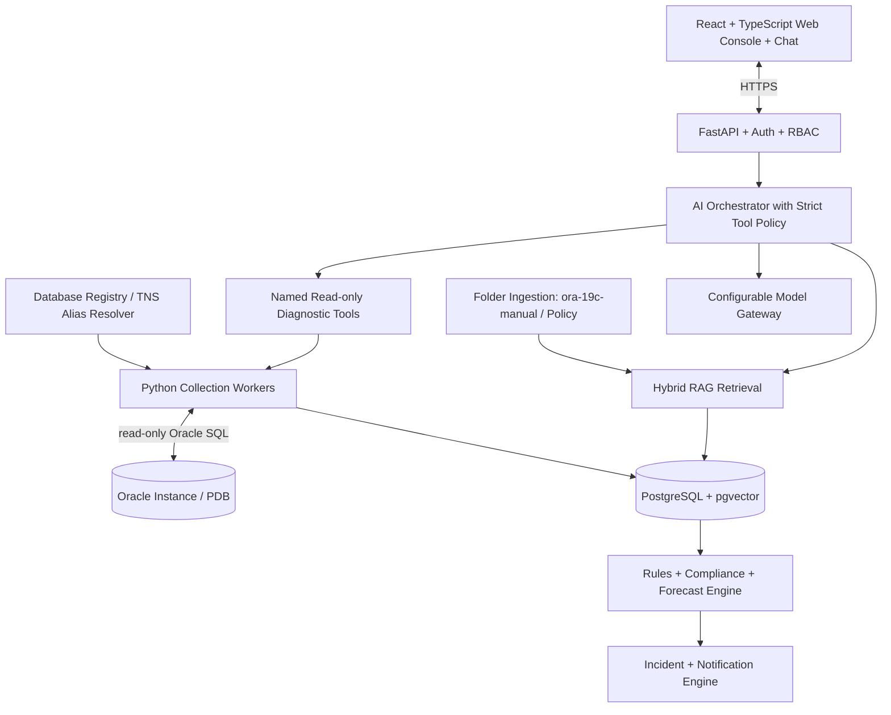

# Oracle Sentinel AI — Architecture

Two illustrated pages go with this file. [docs/architecture_v3.html](architecture_v3.html) lists every component, its default state, and where in the portal it is turned on or off. [docs/architecture_v2.html](architecture_v2.html) has the architecture, data flow, and implementation diagrams. Both are current through Phase 25. [docs/architecture.html](architecture.html) is version 1 and stops at GraphDB.

## Overview

Oracle Sentinel AI is a central, browser-based platform for monitoring registered Oracle databases on Windows Server without installing a custom agent on each database server.

## Technology Stack

| Layer | Choice |
|---|---|
| Backend | Python 3.14, FastAPI, Pydantic v2 |
| Oracle Driver | python-oracledb (thin mode) |
| Frontend | TypeScript + React, Vite |
| Application DB | PostgreSQL + pgvector |
| Scheduler | APScheduler (early) → Celery + Redis |
| Local LLM | Ollama (dev), vLLM (production) |
| Embeddings | `nomic-embed-text` through Ollama, 768 numbers. Word hashing when no model is set |
| Auth | OIDC/OAuth2 with enterprise IdP |
| Notifications | SMTP initially |

## Architecture Diagram

## Knowledge ingestion

Approved files in `knowledge-intake/ora-19c-manual` and `knowledge-intake/Policy` are parsed, chunked, embedded locally, and stored in PostgreSQL. Manual files keep the Knowledge category. Search combines pgvector similarity with full-text ranking and returns a document, version, page, and section citation. Callers only receive passages their ACL allows. Collection, rules, incidents, and alerts do not call this pipeline and do not require a language model. Since Phase 24 the passages are embedded by a model on this computer served by Ollama, as vectors of 768 numbers. Indexing runs once from the launcher: a file whose content and embedding model are unchanged is skipped, a file whose model changed is embedded again from its stored passages, and each file is committed on its own. Search compares only passages of the current model and falls back to keywords when the model does not answer. Remote embeddings are used only when explicitly approved with a privacy disclosure.

## Copilot

The copilot answers from collected application data, approved documents, and a fixed set of read-only database readings. A fixed router chooses the tools. When it has no match on a database chat, the model may nominate up to three readings from the allowlist; the server validates each name against the allowlist and the caller's role and fixes the database. The model is offered no tool to call, and it never receives a SQL execution tool. Database questions about availability, errors, space, growth, performance, blocking, SQL, memory, backups, Data Guard, accounts, and jobs are sent to the local readings MCP server (`python -m sentinel.mcp`). That server accepts a TNS alias and runs one named reading; it does not accept SQL. The model only explains the rows. Fleet chat does not run a single-database reading. A fleet question about connected programs or datafile sizes runs one fixed aggregate reading on every enabled database, a few at a time and up to a limit; fleet questions about incidents, compliance, tablespace percent, and health use stored data. Local Ollama and an approved hosted provider are separate clients. A local failure does not call the hosted provider. Hosted use requires explicit approval, a model name, a `secret://` key reference, and a privacy disclosure. `AI_HOSTED_VENDOR` selects the OpenAI chat API or the Anthropic messages API. An empty base URL uses the vendor's public endpoint. With AI disabled, the same chat still returns guided commands and cited evidence from metrics, incidents, compliance results, and document search. Every allowed or denied tool call is stored in `tool_executions`. In `APP_ENV=dev` or `test`, the local admin principal `sentinel` can choose the local model, Claude, or OpenAI for one answer. Each choice has its own model, base URL, key reference, privacy sentence, timeout, and output limit. Production and every other operator keep the configured provider. A local failure does not call a hosted model. The portal keeps the answer list in a scrolling pane, and New chat opens a fresh thread.

On a database chat a supervisor, one model call, first chooses which specialist answers: this database, Oracle knowledge, SQL draft, company policy, change request, or general. The server checks every name it returns, and two fixed rules sit behind it: an explicit change phrase is always a change request, and a question the fixed patterns recognise as being about this database keeps its reading. A database reading is taken from an agent snapshot no older than fifteen minutes when there is one, and the answer says so. A company requirement is stated only from a policy document. The portal shows which specialist answered.

Since Phase 26 three checks in plain code follow the model. The user reading marks each schema as an application schema or as maintained by Oracle, and a question about which schemas exist is read from the database for an administrator and refused for anyone else, whichever specialist the supervisor chose. An answer that repeats an earlier answer of the same chat to a different question is asked for again, the second time without the earlier messages. An Oracle-knowledge answer that used no manual passage is shown as low confidence.

## Agents

An agent run is controlled by the server, not by the model. The Collector reads packs of the fixed readings through the readings server on one Oracle logon and stores the rows in `evidence_snapshots`. The Investigator follows a fixed playbook: plan, collect, compare with the previous snapshot and stored metrics, look up runbooks and policy, conclude, verify. Only the plan (when no rule matches) and the conclusion call the model, and only the local model. The model returns JSON; the server checks every name against an allowlist and the caller's role. A Verifier in plain code rejects a conclusion whose codes, figures, or names are not in the evidence, or that contains a statement. Runs, steps, and findings are stored and audited. Agents are off by default, and a database can opt out or override the snapshot settings. No agent changes a database.

## Database sections

A database workspace has six read-only views besides the Overview: GraphDB, WaitDB, MemoryDB, StorageDB, ParameterDB, and AlertDB. Each is a route with the database id and a tab in the workspace. Each request opens one Oracle session in the API process and runs fixed readings from the catalog. MemoryDB shows the SGA by pool, the shared pool, the buffer cache, and the PGA. StorageDB shows every tablespace with used and free space, online redo, the recovery area, and the archive destinations. ParameterDB lists the initialization parameters in effect. AlertDB shows the 300 most recent alert log lines. A parameter value that holds a path or an address, and a file path in an alert line, are shown to an administrator only. None of these pages changes Oracle, and none uses a model.

## Graph history

A rate is the change of a counter between two readings. While the scheduler runs, a timer in the API process reads five fixed readings from every enabled database every five minutes and stores the counters as one JSON row in `observations` (`activity.sample`), kept 24 hours by default. GraphDB and WaitDB read the last hour of these rows when they open and replay them through the same rate code they use for live readings, so charts and meters are filled at once. Each page also reads again 3 seconds after it opens. The rows are not written to `current_observations`, so health and rules do not see them. No model is involved and no statement was added.

## Labelled metrics

A metric such as `storage.tablespace.used_pct` is stored once per tablespace at each collection, with the tablespace name as a label. `GET /api/v1/databases/{id}/metrics` takes `label=key=value` filters so a chart reads one series, and the Overview timeline never joins rows of different series into one line. Since Phase 27 the storage probe also stores `storage.tablespace.used_pct_of_max`, used space against the autoextend maximum from `DBA_DATA_FILES.MAXBYTES`. Health and the rules still read `storage.tablespace.used_pct`.

## Proposals and privileged operations

A tablespace extension can be stored and approved. The statement is a fixed template. `POST /api/v1/operations/proposals/{id}/execute` returns `Release 1 does not execute proposals.` Privileged operations are a disabled placeholder at revision `0009`. `GET /api/v1/operations/privileged` and `POST /api/v1/operations/privileged/{id}/execute` return HTTP 501 unless the caller lacks permission, in which case the response is HTTP 403. Each attempt is audited and `privileged_operations` is not written. `OPERATIONS_EXECUTION_ENABLED` defaults to false and cannot be turned on unless `OPERATIONS_EXECUTION_APPROVED` is also set. Both flags still do not send a statement to Oracle. The illustrated page is [docs/architecture.html](architecture.html).

## Non-Negotiable Principles

- **Monitoring never depends on an LLM** — collection, rules, incidents continue if AI is disabled
- **No custom agent on target servers** for baseline Oracle monitoring
- **Read-only by default** — GSYSTEM is a local monitoring user, not a superuser
- **Deny by default** — RBAC, per-database entitlements, named tool allowlists, bounded queries
- **Evidence over confidence** — link explanations to query results, event IDs, and document citations
- **Oracle licensing matters** — no AWR/ASH/ADDM unless explicitly licensed
- **Extensibility** — Oracle-specific SQL stays inside `adapters/oracle`
- **Privileged execution stays off** — proposals are stored, and Release 1 does not run them
